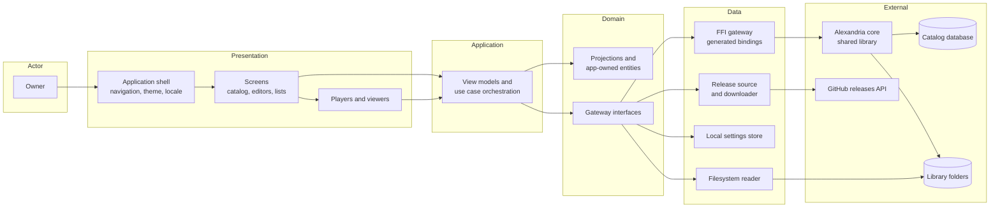
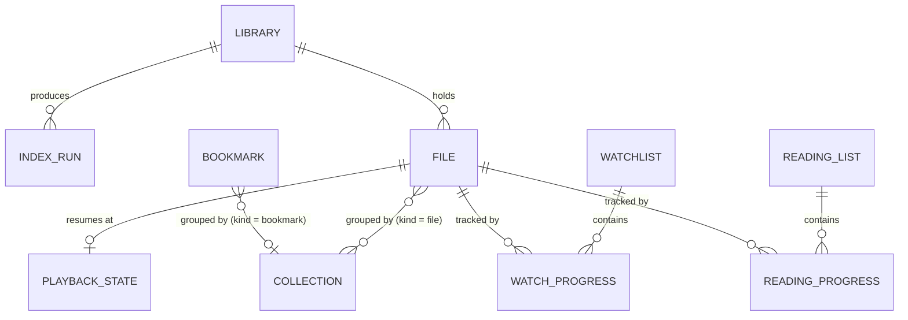
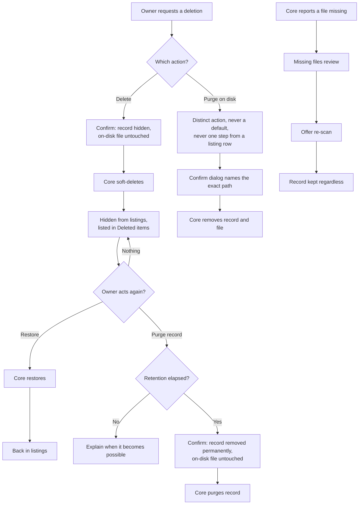

# System Requirements Document — Alexandria UI

## 1. Introduction

### 1.1 Purpose

This document specifies the functional and non-functional requirements for
**Alexandria UI**.

The concrete technology stack — platform and language versions, libraries, local
storage, and tooling — is defined in the
[Technology Stack Document](Technology%20Stack%20Document.md). This document
states requirements and refers to that one for specific technologies and versions
rather than restating them.

Two boundaries shape every requirement below and are stated once here rather than
repeated in each row:

1. **The Alexandria core owns the catalog.** Where a requirement says the
   application shall create, update, or delete catalog data, it does so *through
   the core's FFI surface*. The application never writes catalog state itself and
   never implements a rule the core already enforces.
2. **The disk is read directly for bytes only.** Playback and viewing read the
   file at the path the core reports. Every other interaction with a file — its
   record, its name, its metadata, its lifecycle — goes through the core.

### 1.2 Scope

The application covers adding folders as libraries and indexing them;
pinning, favoriting, and renaming them; browsing each library's folders, and
filtering and sorting their files; searching the catalog; playing video, and playing music in a player bar; viewing documents,
comic books, images, and saved HTML pages; editing video metadata, music tags,
file names, and Markdown and text content;
organizing files and bookmarks into collections; tracking watchlists and reading
lists with per-episode and per-issue progress; carrying out the core's two-phase
deletion lifecycle including the separate purge-on-disk; checking for a newer
release and installing one the owner accepts; and the application
shell that hosts all of it — a left menu of libraries, responsive layout, light
and dark themes, Brazilian Portuguese and English, and consistent loading,
error, and confirmation presentation. There is no login: core 0.7 removed
authentication, and the application starts straight into the shell.

### 1.3 Definitions

Domain nouns are defined once in
[Vision Document §1.3](Vision%20Document.md). The terms below are specific to
this document.

| Term | Definition |
| --- | --- |
| **Gateway** | The abstract interface, declared in the domain layer, through which a domain area reaches the Alexandria core. One per area; implemented once over the generated FFI bindings. |
| **Typed failure** | A member of the application's failure union. Every core status code maps to exactly one, and every one maps to a localized message. |
| **Projection** | An in-memory model of a core-owned entity. Displayed and edited through core calls; never treated as authoritative. |
| **Viewer registry** | The registration table binding a file type to the component that presents it. |
| **Breakpoint** | A window-width threshold at which the shell changes layout. |
| **Left menu** | The panel beside the main area: Home, Bookmarks, then the libraries, pinned ones first. |
| **Pinned library** | A library the owner keeps at the top of the left menu. Stored by the core. |
| **Favorite library** | A library the owner keeps on home. Stored by the core; *preferida* in Portuguese, where *Favoritos* names the bookmarks. |
| **Main area** | The part of the shell beside the left menu, where home, the bookmarks, and an open library are shown. |
| **Perceptible operation** | Any operation that may take longer than 150 ms — every core call, every disk read, and every media load. |

---

## 2. System Overview

The single arrow worth noting is the one that is **absent**: nothing in
Presentation or Application reaches Data directly. Every outward dependency
crosses a gateway interface the Domain layer owns, which is what lets the whole
application run against fakes in tests and what would let an HTTP implementation
replace the FFI one without touching a screen.

---

## 3. Functional Requirements

### 3.1 Authentication and Session — `AU`

| ID | Requirement |
| --- | --- |
| FR-AU-01 | **Removed (0.7 core)** |
| FR-AU-02 | **Removed (0.7 core)** |
| FR-AU-03 | **Removed (0.7 core)** |
| FR-AU-04 | **Removed (0.7 core)** |
| FR-AU-05 | **Removed (0.7 core)** |
| FR-AU-06 | **Removed (0.7 core)** |
| FR-AU-07 | **Removed (0.7 core)** |
| FR-AU-08 | **Removed (0.7 core)** |
| FR-AU-09 | **Removed (0.7 core)** |
| FR-AU-10 | **Removed (0.7 core)** |
| FR-AU-11 | **Removed (0.7 core)** |
| FR-AU-12 | **Removed (0.7 core)** |
| FR-AU-13 | **Removed (0.7 core)** |
| FR-AU-14 | **Removed (0.7 core)** |
| FR-AU-15 | **Removed (0.7 core)** |
| FR-AU-16 | **Removed (0.7 core)** |
| FR-AU-17 | **Removed (0.7 core)** |
| FR-AU-18 | **Removed (0.7 core)** |
| FR-AU-19 | **Removed (0.7 core)** |

Core 0.7 removed authentication, and the application followed it. Alexandria
runs only on the owner's machine, over their own files, and nothing connects
to it over a network, so a login protected nothing. Sign-up, login, sign-out,
the credentials change, and the recovery codes (FR-AU-01 … FR-AU-19) are gone,
with the session and the token every call carried; the numbers stay so that
nothing else is renumbered. Startup ends at the shell (Operations &
Infrastructure §5.1).

### 3.2 Libraries and Indexing — `LB`

| ID | Requirement |
| --- | --- |
| FR-LB-01 | The system shall allow the owner to add a folder as a library, chosen through the platform's native folder picker and named — by the folder's own name unless the owner gives another — from the Library menu's "Add library…", from Manage libraries (FR-LB-27), from the left menu while there is none (FR-CT-20), and from the first-run guidance (FR-LB-11). A library is the only way files reach the catalog: since core 0.6 every file belongs to exactly one library, and nothing is indexed outside one. Rewritten for the 0.6 core: this used to register a source folder, which could then be marked as a library or left as one. Amended for library navigation: the Libraries screen it was added from became the Manage libraries dialog, and the add flow runs over whatever is showing. |
| FR-LB-02 | The system shall present the core's refusal of a folder — not a folder, missing, outside the core's root, or overlapping another library — stating which condition failed. Which folder may be a library is the core's rule, and the application checks nothing of its own before asking. Rewritten for the 0.6 core: the application used to check a folder's existence, readability, and registration itself. |
| FR-LB-03 | The system shall keep no folder list of its own: the libraries are the core's record, read from the core wherever they are shown. Once startup is ready it shall delete, once and silently, the folder list an earlier version kept in its settings (`librarySources`). The 0.6 core already deleted those folders' records when it upgraded the catalog, and the owner adds the folders again as libraries. Rewritten for the 0.6 core: this used to persist the registered source folders, each with its label, its run history, and the file types an index of it recorded. |
| FR-LB-04 | The system shall support any number of libraries and present their files as one merged catalog. |
| FR-LB-05 | The system shall start an index run for a chosen library — "Scan again" on its row — and retain the run identifier the core returns. |
| FR-LB-06 | The system shall start a refresh run covering everything already cataloged, independently of any single library, from Manage libraries ("Re-check all libraries"). This also happens once startup is ready, subject to FR-LB-21. |
| FR-LB-07 | The system shall observe a run's progress without blocking the interface, leaving browsing, playback, viewing, and editing available while it runs. |
| FR-LB-08 | The system shall present the outcome of a finished run — files added, files updated, and files found missing — and shall keep that summary visible until the owner dismisses it. A run that could not record some of the files it walked shall say so, for a scan and for a re-check alike, and shall say it as a problem rather than as one more statistic: those files are on disk and absent from the library, and nothing else in the application will ever mention them. The remedy is another run, which the library's own row already offers. |
| FR-LB-09 | The system shall present the core's refusal to start a second index run for a library, or to move it (FR-CT-17), while a run of that library is running or paused, in the core's own words, which name the unfinished run. The owner resumes, pauses, or cancels that run instead (FR-LB-16). |
| FR-LB-10 | The system shall allow the owner to remove a library after a confirmation stating that removing it deletes it from the catalog with its files, their reading and watching positions, their place in collections, and its runs, and that nothing on disk is touched. Where the library has a paused run, the confirmation shall add that the paused scan is discarded too. The core refuses to remove a library while one of its runs is running, and the system shall present that refusal. Rewritten for the 0.6 core: un-registering a source folder used to leave the catalog untouched, and un-marking a library used to return its files to the type panels. |
| FR-LB-11 | The system shall present first-run guidance on home directing the owner to add a library whenever there is none, and only once the list of libraries has loaded empty; its action, and the left menu's and an empty search's, shall start adding one where the owner is (FR-LB-01). |
| FR-LB-12 | The system shall follow, with the library's run status — under its row in Manage libraries, in its page header, and on its card on home — the index run the core starts when a library is added, so that a newly added library does not sit uncatalogued until the owner asks separately. |
| FR-LB-13 | The system shall present, for every run in flight, the phase it is in, how many entries it has processed, how many it found, and how long it has been working, updating these as the run proceeds. |
| FR-LB-14 | The system shall derive a remaining-time estimate for a run in flight from its own observed rate, and shall present none where the run has not yet reported a total to divide by. |
| FR-LB-15 | The system shall present a persistent background activity indicator, in the shell outside Manage libraries, whenever any run is outstanding — so that a scan started from one screen remains visible from every other. It shall name a run by its library, falling back to the root folder's name, and a refresh as the catalog's; its "View all" opens Manage libraries. |
| FR-LB-16 | The system shall allow the owner to pause a running scan, resume a paused one, and cancel either, from the library's run status (FR-LB-12) and from the background activity indicator alike. |
| FR-LB-17 | The system shall confirm a cancellation before sending it, stating that the run is abandoned rather than paused, and shall not confirm a pause. |
| FR-LB-18 | The system shall start a run at the normal pace, and allow the owner to change the pace — normal or low — of a run already under way by pausing and resuming it at the new pace. A resume for which no pace is named shall keep the pace the run already has. Amended for the 0.6 core: adding a library no longer asks for a pace, since the answer can be changed from the background activity indicator a moment later. |
| FR-LB-19 | The system shall offer every run the core reports as outstanding at launch — including one left behind by a previous run of the application — for the owner to resume or cancel, and shall resume none of them by itself. |
| FR-LB-20 | The system shall continue to follow every other outstanding run when one of them ends, fails to be read, or is abandoned. |
| FR-LB-21 | The system shall re-check the catalog once startup is ready, unless the owner has turned that off, the catalog holds no files, or a run is already outstanding; and shall report such a re-check through the background activity indicator (FR-LB-15) without announcing a refusal the owner did not ask for. |
| FR-LB-22 | **Removed (0.6 core)** — a folder is a library or is not in the catalog at all, so there is nothing to mark or unmark: adding a library is FR-LB-01 and removing one FR-LB-10. |
| FR-LB-23 | The system shall name, on request, the files a finished run could not record, each with the reason the core gave (core FR-FC-42), so that the count in a run's report can be acted on rather than only read. Those files are on disk and in no listing; without their paths the owner has nowhere to look. The list is read when it is asked for, not carried on the status the application polls. |
| FR-LB-24 | The system shall pin and unpin a library through the core (`alexandria_library_set_pinned`), from the library's context menu in the left menu (right-click or long-press) and from the Pin toggle in its page header. The core stores the choice, so it survives restarts. The application reads the libraries again once the core accepts, and shows nothing the core did not: when the core refuses, the entry stays where it was and a snackbar says the change could not be saved. Added for library navigation. |
| FR-LB-25 | The system shall mark and unmark a library as a favorite through the core (`alexandria_library_set_favorite`), from the same two places as a pin, under the same rule when the core refuses. A favorite is shown with a filled star in the context menu and the header, and is listed on home (FR-CT-11). Pins and favorites are independent. In Portuguese a favorite library is *preferida*, because *Favoritos* names the bookmarks. Added for library navigation. |
| FR-LB-26 | The system shall rename a library through the core (`alexandria_library_rename`) at any time — while a run of it is running or paused included — from its context menu in the left menu, from the menu in its page header, and from its row in Manage libraries. The name dialog opens with the current name filled in and selected, and Confirm is disabled while the field is blank, the same rule as when a library is added. When the core refuses, the dialog stays open with the core's message. Once the core accepts, the left menu, the page header, home's favorites, and Manage libraries show the new name, and the left menu sorts it again. Added for library navigation: a library's name used to be set only when it was added. |
| FR-LB-27 | The system shall offer library management in the menu bar: the Library menu opens with a Libraries heading holding "Add library…" (FR-LB-01) and "Manage libraries…". Manage libraries is a dialog listing every library with its name, its root folder, and its run status, each row offering Rename, Scan again, Move, and Remove, beside "Add a library" and "Re-check all libraries" (FR-LB-06); choosing a row opens that library in the main area (FR-CT-21). Added for library navigation: this was the Libraries screen, a destination of its own in the navigation panel. |

### 3.3 Catalog Browsing and Search — `CT`

| ID | Requirement |
| --- | --- |
| FR-CT-01 | **Removed (navigation by library)** — the left menu lists no file types. It used to list every type in the library (videos, music, books, comic books, notes and text files, HTML pages, and images), each with its count, beside the bookmarks and the libraries. The owner knows where things are by the folders they chose, so the left menu now lists Home, Bookmarks, and the libraries (FR-CT-20), a library's files are filtered by type inside it (FR-CT-07), and the count of each type is on home (FR-CT-22). |
| FR-CT-02 | **Removed (navigation by library)** — there is no listing of one type's files across the catalog. A library's folder shows its files, filtered to one type on request (FR-CT-07), and search finds files across every library (FR-CT-06). |
| FR-CT-03 | The system shall offer three layouts for a library folder's files — list, list with details, and grid — and switch between them on request. Folders are drawn in the same layout, before the files. |
| FR-CT-04 | The system shall remember the chosen layout, type filter, and sort across restarts, as one choice for every library rather than one per library or per type. Rewritten for library navigation: the layout was remembered per file type, on the type's page. |
| FR-CT-05 | The system shall present a detail view for a single file showing its type-specific metadata, its path, and its lifecycle state. |
| FR-CT-06 | The system shall search the catalog by file name and by type-specific metadata, a track's tags included, and present matches across every type, each naming the library it lives in. |
| FR-CT-07 | The system shall filter a library folder's files to one file type — videos, music, books, comic books, notes, pages, or images — or show every type, never filtering the folders. A folder with files but none of the chosen type says so ("No <type> in this folder") and offers to clear the filter. Rewritten for library navigation: this filtered a type's listing by lifecycle state; a deleted record is reached through Deleted items (FR-LC-03), never inside a library. |
| FR-CT-08 | The system shall sort a library folder's files by name, by the date they were indexed, or in album order (FR-CT-19), ascending or descending, always after the folders, which come first, A–Z. Names compare without regard to case. |
| FR-CT-09 | The system shall present an empty-result state that is visually distinct from a loading state and from an error state. |
| FR-CT-10 | The system shall render long catalog listings without materializing every row, so that scrolling cost does not grow with the size of the library. |
| FR-CT-11 | The system shall present home in two sections that load and fail on their own: the favorite libraries (FR-LB-25), A–Z, as cards showing each one's name, root folder, and run status, a card opening its library; and the statistics (FR-CT-22). With no favorite, the first section says "Mark a library as a favorite to see it here". A section whose query fails shows its own failure and retry while the other still renders. Rewritten for library navigation: home showed recently added items, items in progress, per-type counts, and the outcome of the most recent index run, and the owner chose favorites and totals instead. |
| FR-CT-12 | The system shall open the viewer or player registered for a file's type from any listing or from the detail view. Selecting a file in a listing shall open it, and its details shall be reachable in one press from beside it; a file with no viewer, and one missing from disk, shall present their details instead, since neither can be opened. |
| FR-CT-13 | The system shall present a track by its tags wherever it is listed — a library's folders, search results, the delete confirmation, the missing-files review, and the player bar — naming it by its title, or by its file name when it has none. A row in a library's folder shows the title, then artist · album, and the duration. Reinstated for the 0.6 core, which knows audio again; the music area's context menu (FR-CT-14) stays removed. Amended for library navigation: the Music panel and home's recent files, which listed tracks too, are gone. |
| FR-CT-14 | **Removed (moved out of scope, see Orpheus)** |
| FR-CT-15 | The system shall present a library's files in their folders on disk, one level at a time, when the library is opened from the left menu (FR-CT-20) or from its card on home. A library exists so that a folder whose structure *is* its meaning — a course, with each class's recording and handouts side by side — keeps that structure; a flat listing of its files answers a question nobody asked of it. Adding one starts its first index run (FR-LB-12): the tree is built from what the catalog holds beneath the root, not from a walk of the disk, so until that run has recorded something the library shows nothing at all — no files, and no folders either — and says so. Amended for library navigation: the folders are now the way to a library's files, with search, rather than a second way beside the type panels. |
| FR-CT-16 | **Removed (0.6 core)** — every file belongs to a library now, so a library's files are listed in the type panels, their counts, the home dashboard, search, the deleted-items and missing-files reviews, and the collection picker like any other. |
| FR-CT-17 | The system shall let the owner correct a library's folder after it moves on disk, by picking the folder it moved to. The library's files move with it and keep their identity (core FR-FC-41), so nothing that references them is lost. A destination that overlaps another library, or that the catalog already holds files for, is refused in those terms rather than generically, and so is a move while a run of the library is running or paused (FR-LB-09). |
| FR-CT-18 | The system shall offer, from a file's detail view, the actions that add it to the owner's lists — a watchlist for a video, a reading list for a book or comic — so that a file reached through a library's folders or a search can be added to them. |
| FR-CT-19 | The system shall offer an album sort beside the name and date sorts: by album artist (falling back to artist), then album, then track number, then title, all without regard to case, with untagged values last and in file-name order. It is offered whatever the type filter, and saved with the other choices (FR-CT-04). The player's next and previous follow the order shown (FR-PL-06), which is why it exists: an album has to play in its own order, not in the order of its file names. Amended for library navigation: it was the Music panel's default; the default is now the name sort. |
| FR-CT-20 | The system shall list in the left menu, top to bottom: Home; Bookmarks; the pinned libraries (FR-LB-24), A–Z by name without regard to case; a divider, drawn only when both groups have a library in them; and the other libraries, A–Z. There is no other ordering and no file-type entry. Each library entry shows a folder icon, with a pin on it when the library is pinned, and the library's name; it opens the library in the main area (FR-CT-21) and carries a context menu — right-click or long-press — with Pin or Unpin, Add to favorites or Remove from favorites, and Rename… (FR-LB-24 … FR-LB-26). With no library, the libraries part of the menu is a single "Add a library" entry that starts adding one; when the libraries could not be read, it is a single "Libraries didn't load. Try again" entry that reads them again and is never a destination. When the library shown in the main area is removed, the shell goes to Home. Added for library navigation. |
| FR-CT-21 | The system shall open a library in the main area with: a header naming it, with its Pin and Favorite toggles, a menu holding Rename, Scan again, Move…, and Remove, and its run status; breadcrumbs from the library's root to the open folder, each but the last opening its level; a toolbar with the type filter (FR-CT-07), the sort (FR-CT-08), and the layout (FR-CT-03); and the open folder's folders, A–Z, then its files, drawn with the application's shared file rows and tiles, so that every action a file has — open, play, read, details, edit, rename, delete — is there. The folder open in each library is kept while the application runs, so that leaving a library and coming back returns to it, and is not kept across restarts. An empty folder says "Nothing in this folder". Added for library navigation: a library opened as a dialog over the Libraries screen. |
| FR-CT-22 | The system shall present on home the catalog's statistics, read from the core (`alexandria_catalog_stats_json`): "N libraries", then a row per file type with its count — videos, music, books, comic books, notes, pages, and images — all seven, zeroes included, because the core answers every type. On failure the section shows the error and a retry and never a zero it could not count. The statistics are read again when a run finishes, when a library is added or removed, and after a lifecycle change (FR-LC-09). Added for library navigation. |

### 3.4 Metadata and Content Editing — `ME`

| ID | Requirement |
| --- | --- |
| FR-ME-01 | The system shall edit an audio file's tags through the core — title, artist, album artist, album, year, genre, and track number — from the file's detail view, which also shows the tags and the duration. Reinstated for the 0.6 core, which knows audio again. |
| FR-ME-02 | The system shall edit a video file's metadata through the core, including whether it is a movie or a series. |
| FR-ME-03 | The system shall validate editable fields before the call for immediate feedback, and shall present the core's rejection as final when it disagrees. |
| FR-ME-04 | The system shall rename any file through the core, rejecting names containing characters the host operating system forbids before the call is made. |
| FR-ME-05 | The system shall reflect a completed rename or metadata edit in every open listing and detail view without requiring a manual refresh. |
| FR-ME-06 | The system shall read a text or Markdown file's content through the core for editing. |
| FR-ME-07 | The system shall present a Markdown and text editor with a live rendered preview alongside the source. |
| FR-ME-08 | The system shall write edited content back through the core only when it differs from the content that was loaded. |
| FR-ME-09 | The system shall warn the owner before discarding unsaved editor changes. |
| FR-ME-10 | The system shall report a disk failure reported by the core without altering the content shown in the editor. |

### 3.5 Media Playback — `PL`

| ID | Requirement |
| --- | --- |
| FR-PL-01 | The system shall play a video file from its on-disk path without transcoding it. |
| FR-PL-02 | The system shall offer full-screen toggling, pause and resume, and seeking forward and backward during video playback. |
| FR-PL-03 | The system shall list the subtitle tracks available in a video and switch between them, including turning subtitles off. |
| FR-PL-04 | The system shall list the audio tracks available in a video and switch between them. |
| FR-PL-05 | The system shall play an audio file from its on-disk path in a player bar docked at the bottom of the shell, which remains while the owner navigates elsewhere in the application. The bar shows the track's cover, its title and artist (FR-CT-13), previous, play and pause, and next, where the track has reached against its length with seeking, and a control that stops playback and hides the bar; the title opens the track's details. Reinstated for the 0.6 core, without the full-window player (FR-PL-07). |
| FR-PL-06 | The system shall play, as a queue, the list a track was started from: the open library folder's audio files in the order shown — after its type filter and sort (FR-CT-07, FR-CT-08) — or the track alone when it was started from search or its details. Deleted records are left out of the queue. Next and previous move within it, the next track plays when one ends, and playback stops after the last; there is no shuffle and no repeat. Reinstated, narrowed, for the 0.6 core: albums, artists, and playlists are not queued, because none of them is browsed. Amended for library navigation: the Music panel and home, which started queues too, no longer list tracks |
| FR-PL-07 | **Removed (moved out of scope, see Orpheus)** |
| FR-PL-08 | The system shall keep at most one playback session playing: opening a video pauses the music. |
| FR-PL-09 | The system shall persist a resume position for a played video and offer to resume from it when the file is opened again. A track keeps none and starts from its beginning each time. |
| FR-PL-10 | The system shall report a file that is missing on disk or cannot be decoded as a readable failure, without terminating the application. |
| FR-PL-11 | **Removed (moved out of scope, see Orpheus)** |
| FR-PL-12 | **Removed (moved out of scope, see Orpheus)** |
| FR-PL-13 | **Removed (moved out of scope, see Orpheus)** |
| FR-PL-14 | **Removed (moved out of scope, see Orpheus)** |
| FR-PL-15 | **Removed (moved out of scope, see Orpheus)** |
| FR-PL-16 | **Removed (moved out of scope, see Orpheus)** |
| FR-PL-17 | **Removed (moved out of scope, see Orpheus)** |
| FR-PL-18 | The system shall skip a queued track that cannot be opened — missing on disk or unreadable — naming it briefly in the player bar and playing the next; only when nothing left in the queue opens shall it stop, with a readable failure that offers a re-scan as the video player does (FR-PL-10). One missing file does not end an album. |
| FR-PL-19 | The system shall stop music when the application closes for an update (FR-UP-12), and shall drop a removed library's tracks from the queue (FR-LB-10), stopping playback when the track playing is one of them. Amended for the 0.7 core: music also stopped when the owner signed out, and there is no signing out |

Audio came back with the 0.6 core as files to play, not as a music library to
manage, which stays Orpheus's. The full-window player (FR-PL-07, FR-PL-11,
FR-PL-12), lyrics and artist photographs (FR-PL-13, FR-PL-15, FR-UX-13),
browsing by artist and album (FR-PL-14), play history and statistics (FR-PL-16,
FR-PL-17), and playlists (FR-TR-15 … FR-TR-20) remain removed.

### 3.6 Document, Image, and Page Viewing — `VW`

| ID | Requirement |
| --- | --- |
| FR-VW-01 | The system shall resolve the component that presents a file from a registry keyed by file type, so that adding a type or replacing a viewer is a registration rather than a change to the listing or detail screens. |
| FR-VW-02 | The system shall present PDF and e-book documents with page or chapter navigation and a remembered reading position. |
| FR-VW-03 | The system shall present a comic book page by page, reading pages from the archive without extracting it to disk. |
| FR-VW-04 | The system shall present an image with fit-to-window and zoom controls. |
| FR-VW-05 | The system shall render a saved HTML page with an embedded browser engine, so that the page appears as it did in the browser it was saved from: its own stylesheets, layout, media queries and script. The page shall be loaded from its own path on disk, and the engine shall be configured so that a document loaded that way cannot read other local files. Where the engine cannot be started, the system shall fall back to rendering the markup as widgets — the page's own stylesheets resolved onto the elements they select, its folder as the base for relative references, no script executed and no frame embedded — rather than presenting nothing. |
| FR-VW-06 | The system shall present a Markdown file as rendered content when it is opened for reading rather than for editing. |
| FR-VW-07 | The system shall read a file's bytes at the moment it is opened and shall not retain them across application runs. |
| FR-VW-08 | The system shall report a file type with no registered viewer, or a viewer whose dependency is unavailable, as a readable failure that offers the file's other actions. |

### 3.7 Collections and Bookmarks — `OG`

| ID | Requirement |
| --- | --- |
| FR-OG-01 | The system shall create a collection of a chosen kind — file or bookmark — through the core. |
| FR-OG-02 | The system shall rename a collection through the core. |
| FR-OG-03 | The system shall delete a collection through the core, after a confirmation stating that its contained items are preserved and only the grouping is removed. |
| FR-OG-04 | The system shall add one or more items to a collection of the matching kind through the core. |
| FR-OG-05 | The system shall remove an item from a collection through the core, leaving the item itself in the catalog. |
| FR-OG-06 | The system shall list the members of a collection through the core. |
| FR-OG-07 | The system shall present collection navigation — listing, breadcrumbs, and moving an item between collections — against a hierarchical model whose present depth is one, so that nested collections become a change of data rather than of interface. |
| FR-OG-08 | The system shall create a browser bookmark with a URL, a title, and an optional bookmark collection, through the core. |
| FR-OG-09 | The system shall update a bookmark's URL, title, and containing collection through the core. |
| FR-OG-10 | The system shall list bookmarks, optionally filtered by their containing collection. |
| FR-OG-11 | The system shall open a bookmark's URL in the platform's default browser. |
| FR-OG-12 | The system shall reject a URL that does not parse, and a blank title, before calling the core. |

### 3.8 Watchlists and Reading Lists — `TR`

| ID | Requirement |
| --- | --- |
| FR-TR-01 | The system shall create a named watchlist through the core. |
| FR-TR-02 | The system shall delete a watchlist through the core, after a confirmation stating that the videos themselves are preserved. |
| FR-TR-03 | The system shall add a video to a watchlist through the core, and shall offer that action only for video files. |
| FR-TR-04 | The system shall remove a video from a watchlist through the core. |
| FR-TR-05 | The system shall list watchlists together with each item's watch state and progress. |
| FR-TR-06 | The system shall update an item's watch state through the core across the states the core defines. |
| FR-TR-07 | The system shall record and present per-episode progress for an item marked as a series, and single-item progress for a movie. |
| FR-TR-08 | The system shall create a named reading list through the core. |
| FR-TR-09 | The system shall delete a reading list through the core, after a confirmation stating that the books and comics themselves are preserved. |
| FR-TR-10 | The system shall add a book document or a comic book to a reading list through the core, and shall offer that action only for those file types. |
| FR-TR-11 | The system shall remove an item from a reading list through the core. |
| FR-TR-12 | The system shall list reading lists together with each item's read state and progress. |
| FR-TR-13 | The system shall update an item's read state through the core across the states the core defines. |
| FR-TR-14 | The system shall record and present per-issue progress for a comic that belongs to a series, and single-item progress for a standalone book. |
| FR-TR-15 | **Removed (moved out of scope, see Orpheus)** |
| FR-TR-16 | **Removed (moved out of scope, see Orpheus)** |
| FR-TR-17 | **Removed (moved out of scope, see Orpheus)** |
| FR-TR-18 | **Removed (moved out of scope, see Orpheus)** |
| FR-TR-19 | **Removed (moved out of scope, see Orpheus)** |
| FR-TR-20 | **Removed (moved out of scope, see Orpheus)** |

### 3.9 Deletion Lifecycle — `LC`

| ID | Requirement |
| --- | --- |
| FR-LC-01 | The system shall soft-delete a file or bookmark through the core, after a confirmation stating explicitly that the on-disk file is not affected. |
| FR-LC-02 | The system shall exclude soft-deleted records from the default listings. |
| FR-LC-03 | The system shall present a view of soft-deleted records, showing for each how long it remains restorable. |
| FR-LC-04 | The system shall restore a soft-deleted record through the core and return it to the default listings. |
| FR-LC-05 | The system shall purge a soft-deleted record through the core after a confirmation stating that the record is removed permanently and the on-disk file is not. |
| FR-LC-06 | The system shall present purge-on-disk as an action distinct from every other deletion: never the default action, never reachable in a single interaction from a listing row, and confirmed by a dialog naming the exact file path to be deleted. |
| FR-LC-07 | The system shall present the core's rejection of a purge attempted before its retention window elapsed as a readable explanation of when it becomes possible. |
| FR-LC-08 | The system shall present files the core reports as missing on disk in a dedicated review, offering a re-scan, and shall never delete a record because its file is missing. |
| FR-LC-09 | The system shall refresh every affected listing, counter, and detail view after any lifecycle change completes. |

### 3.10 Application Shell, Theming, and Localization — `UX`

| ID | Requirement |
| --- | --- |
| FR-UX-01 | The system shall present a single-window shell comprising the menu bar — the Library menu (FR-LB-27 and the library-wide screens), the search field, and the Settings menu — the left menu (FR-CT-20), and the main area. Amended for library navigation: the panel beside the main area listed file types; it now lists Home, Bookmarks, and the libraries |
| FR-UX-02 | The system shall adapt the shell across the defined width breakpoints, collapsing the left menu and the menu bar rather than clipping or hiding any control: the left menu draws its entries with labels beside their icons where there is room, with labels beneath them at the medium width, and as icons with the label as a tooltip at the narrowest. However many libraries there are, the left menu scrolls rather than dropping or clipping one. Amended for library navigation: the left menu is no longer a navigation rail, which can neither draw a divider between entries nor give one a context menu |
| FR-UX-03 | The system shall enforce the minimum supported window size and shall persist and restore the window's size and position across runs. |
| FR-UX-04 | The system shall offer light, dark, and system-matching themes, applying a change immediately without restarting. |
| FR-UX-05 | The system shall offer Brazilian Portuguese and English, applying a change immediately without restarting. |
| FR-UX-06 | The system shall present every user-visible string from the localization catalog, complete in both supported languages. |
| FR-UX-07 | The system shall derive every color, spacing value, and text style from the active theme rather than from a literal declared in a component. |
| FR-UX-08 | The system shall present a loading state for every perceptible operation. |
| FR-UX-09 | The system shall present every failure as a localized, human-readable message derived from the core's status code, never as a raw status code and never as a silent no-operation. |
| FR-UX-10 | The system shall confirm every destructive action through a modal that names what will be removed and whether the on-disk file is affected. |
| FR-UX-11 | The system shall make the primary action of every screen reachable from the keyboard: Return shall submit the form the focus is in, from any of its fields, and Tab shall move between them. Neither key shall do the other's work — a field that moves the focus on Return leaves a form that can only be sent from its last field. A field holding more than one line of text keeps Return for a new line, and is the only exception. |
| FR-UX-12 | The system shall persist the owner's theme, language, layout, sort, and filter preferences locally and restore them at launch. |
| FR-UX-13 | **Removed (moved out of scope, see Orpheus)** |

### 3.11 Updates — `UP`

| ID | Requirement |
| --- | --- |
| FR-UP-01 | The system shall check for a newer release once per application start, when startup reaches ready, in the background and without delaying or blocking startup — and only when the build is a release build (never a debug or profile build), the owner's "Check for updates at startup" preference is on, and the installation is not the Flatpak. It shall not check periodically while it runs. |
| FR-UP-02 | The system shall ask for the latest release with one `GET` to GitHub's public releases API, `https://api.github.com/repos/artur-rios/alexandria-ui/releases/latest`, which leaves out pre-releases and drafts, sending only the headers `Accept: application/vnd.github+json` and `User-Agent: Alexandria/<version>`, and giving up after 10 seconds. It shall send nothing else and no telemetry. The URL may be replaced at build time so that tests can point it elsewhere. |
| FR-UP-03 | The system shall compare the latest release's tag, without its `v`, with the running version as SemVer `major.minor.patch`, ignoring a tag that does not parse, and shall offer a release only when it is newer than the running one. It shall never offer a downgrade. |
| FR-UP-04 | The system shall log a failed check at startup — offline, timed out, rate-limited, a server error, or an unreadable answer — and show nothing. |
| FR-UP-05 | The system shall offer a newer release in a prompt over the shell as soon as the check answers, but never over another dialog: if one is open, the prompt waits until it closes. The prompt shall show the new version, "You have <current>", the release's notes rendered as Markdown, and three choices: Update now, Later, and Skip this version. |
| FR-UP-06 | The system shall, on Later, store nothing and ask again at the next start; and on Skip this version, store the version (`updates.skippedVersion`) and not offer it again at startup, while still offering any release newer than it. |
| FR-UP-07 | The system shall offer in Preferences a "Check for updates at startup" switch, on by default and persisted (`settings.checksForUpdates`), and a "Check now" action that runs the same check and reports "You're up to date", reports "Couldn't check for updates", or opens the prompt. "Check now" shall offer a skipped version too: it is an explicit request, and the only way to undo a skip. |
| FR-UP-08 | The system shall install an update itself only for an installation it recognises as able to replace itself, from facts on disk: the Windows installer's copy (its uninstall key's install location is the running executable's folder, and the running user can write to it), the Linux installer's copy (its manifest's prefix contains the running executable, and the running user can write to it), and an AppImage in a folder the running user can write to. Every other installation — the `.deb`, the zip or tarball, MSIX, a Program Files or root-owned install the running user cannot write to, and anything unrecognised — shall be treated as one that cannot update itself. |
| FR-UP-09 | The system shall, for an installation that cannot update itself, and for a release that publishes no checksums file for this installation, say in the prompt that this copy cannot update itself and offer "Open release page", which opens the release in the default browser, in place of Update now. |
| FR-UP-10 | The system shall, on Update now, download the release's package for this installation into a fresh temporary folder, showing its progress and offering Cancel. A cancelled download shall be deleted and return the owner to the offer; a failed one shall be deleted and say that the update could not be downloaded. |
| FR-UP-11 | The system shall verify a downloaded package's SHA-256 against its line in the checksums file the release publishes beside its packages — `alexandria-<version>-windows-SHA256SUMS` or `alexandria-<version>-linux-SHA256SUMS` — and, when the digest does not match or the file has no line for the package, delete the download, say that it could not be verified, and run nothing. |
| FR-UP-12 | The system shall close for a verified update through a path of its own, leaving ordinary window closing unchanged: confirm discarding unsaved edits ("Update and discard"), returning to the offer and deleting the download when the owner declines; say that a running scan will pause and can be resumed after the update; end the application's activities — the catalog, indexing, the editor, and playback, which begin once startup is ready — but not the update check, which starts at the same moment and is not one of them, since ending it would cancel the very download being installed; record the window geometry; write the pending-update record (`update-pending.json`); start the installer detached; and exit. |
| FR-UP-13 | The system shall install by the installation's kind: on Windows, by running the release's setup with `/SILENT /SUPPRESSMSGBOXES /NORESTART /UPDATE /DIR="<install folder>"`; on Linux, through a small `sh` helper that waits for the application to exit, runs the release's installer with `--yes --prefix <prefix>` or replaces the AppImage by an atomic rename, starts the application again — the old one when the install failed — and deletes the temporary folder. The owner's data shall not be touched. |
| FR-UP-14 | The system shall, at the next start, read the pending-update record and delete it; and when the running version is older than the one the record names, show in the prompt's place a notice, "The update to <version> did not complete", with "Open release page". |
| FR-UP-15 | The system shall never check for updates from the Flatpak, and shall hide its update switch and "Check now": the Flatpak has no network permission, and granting it one would also open the network to saved pages (NFR-12). |

Updating in place needs the release to publish its checksums. The installers'
part — staging the new version and swapping in only their own files, so that a
failed update leaves the old version working, and the Windows setup's
`/UPDATE` switch — and the checksums files belong to the release packaging
([Operations & Infrastructure §7.2](Operations%20%26%20Infrastructure%20Document.md)).
Releases up to and including 1.0.1 publish no checksums, so the first release
that does is installed by hand, once.

---

## 4. Data Model

### 4.0 Identifier Strategy

The application introduces **no identifier of its own** for any core-owned
entity. Every file, collection, bookmark, watchlist, and reading list is
addressed by the **public UUID string** the core returns, and that UUID is what
every call passes back. The core's internal keys are never exposed across the FFI
boundary and consequently never exist in this application.

The application's own entities are keyed by what naturally identifies them: an
`IndexRun` by the run identifier the core returned when it started, and
`AppSettings` by being a singleton. A library is the core's, addressed by its
UUID like every other core-owned entity; the application keeps no folder record
of its own. A
`PlaybackState` is keyed by the file UUID it belongs to, which means a purged
file's resume point is identifiable and removable.

### 4.1 Entity Relationship Diagram

`LIBRARY`, `FILE`, `BOOKMARK`, `COLLECTION`, `WATCHLIST`, `WATCH_PROGRESS`,
`READING_LIST`, and `READING_PROGRESS` are **projections** of core-owned
entities; the field tables below list what the application consumes from each,
not what the core stores. Every file belongs to exactly one library.
`INDEX_RUN` is the core's too — it stores every run and lists the running and
paused ones — and the application keeps only what it followed since startup,
in memory. `PLAYBACK_STATE` and `APP_SETTINGS` are owned by the application and
persisted in the local settings store. There is no `SESSION` any more: core 0.7
removed authentication, and nothing authorizes a call.

### 4.2 File (projection)

| Field | Type | Constraints | Description |
| --- | --- | --- | --- |
| uuid | string | Required, from the core | The public identifier passed on every call about this file. |
| name | string | Required, editable | The file name on disk. |
| path | string | Required, read-only | The absolute on-disk path. Used to read bytes for playback and viewing. |
| type | enum | Required | The file's type, which selects the viewer and the available actions. |
| state | enum | Required | The lifecycle state the core reports — active, deleted, or missing. |
| contentHash | string | Required, read-only | The core's content hash. Used to detect that a file changed since it was listed. |
| metadata | type-specific | Optional | The subtype metadata the core returns for this file's type, edited through the core — a video's metadata, or a track's tags and duration. |
| libraryUuid | string | Required, from the core | The library the file belongs to. |
| deletedAt | timestamp | Present when deleted | Drives the remaining-restorable indication in the deleted view. |

### 4.3 Bookmark (projection)

| Field | Type | Constraints | Description |
| --- | --- | --- | --- |
| uuid | string | Required, from the core | Public identifier. |
| url | string | Required, must parse as a URL | The target opened in the default browser. |
| title | string | Required, non-empty | The label shown in listings. |
| collectionUuid | string | Optional | The bookmark collection containing it, if any. |
| state | enum | Required | Lifecycle state, as for a file. |

### 4.4 Collection (projection)

| Field | Type | Constraints | Description |
| --- | --- | --- | --- |
| uuid | string | Required, from the core | Public identifier. |
| name | string | Required, non-empty after trimming | Display name. |
| kind | enum | Required — file or bookmark | Determines which items may be added. |
| itemCount | integer | Derived | Shown in listings; recomputed after membership changes. |

### 4.5 Watchlist and WatchProgress (projections)

| Field | Type | Constraints | Description |
| --- | --- | --- | --- |
| watchlist.uuid | string | Required | Public identifier. |
| watchlist.name | string | Required, non-empty | Display name. |
| progress.videoUuid | string | Required | The video this progress belongs to. |
| progress.state | enum | Required | The watch state the core defines. |
| progress.currentEpisode | integer | Optional, series only | Current episode for a series. |
| progress.totalEpisodes | integer | Optional, series only | Total episodes, when known. |

### 4.6 ReadingList and ReadingProgress (projections)

| Field | Type | Constraints | Description |
| --- | --- | --- | --- |
| readingList.uuid | string | Required | Public identifier. |
| readingList.name | string | Required, non-empty | Display name. |
| progress.itemUuid | string | Required | The book or comic this progress belongs to. |
| progress.state | enum | Required | The read state the core defines. |
| progress.currentIssue | integer | Optional, comic series only | Current issue. |
| progress.totalIssues | integer | Optional, comic series only | Total issues, when known. |

### 4.7 Library (projection)

| Field | Type | Constraints | Description |
| --- | --- | --- | --- |
| uuid | string | Required, from the core | Public identifier. |
| name | string | Required, non-empty, editable | The owner's name for the library, defaulting to the folder's name. Renamed through the core at any time (FR-LB-26). |
| rootPath | string | Required, from the core | The folder the library stands for. Corrected through the core when it moves (FR-CT-17). |
| pinned | boolean | Required, from the core | Whether the library is listed among the pinned ones at the top of the left menu (FR-LB-24). Stored by the core. |
| favorite | boolean | Required, from the core | Whether the library is on home (FR-LB-25). Stored by the core. |

This replaces the application-owned `LibrarySource`, the folder list 0.5 kept in
the settings store with each folder's label, run history, and recorded file
types. The 0.6 core keeps the libraries itself, and the application deletes the
old list once startup is ready (FR-LB-03).

### 4.8 IndexRun (application-owned)

| Field | Type | Constraints | Description |
| --- | --- | --- | --- |
| runId | string | Required, from the core | The run identifier the core returned. |
| kind | enum | Required — scan or refresh | Which operation started it. |
| libraryUuid | string | Required for a scan, absent for a refresh | The library being scanned. |
| status | enum | Required — running, finished, failed | Observed state. |
| filesIndexed | integer | Derived | Files counted so far. |
| filesMissing | integer | Derived | Cataloged files found missing. |
| startedAt | timestamp | Required | When it started. |

### 4.9 Session

**Removed (0.7 core).** The session held the credential the core returned at
login, the account's address, and how many recovery codes remained. Core 0.7
removed authentication, so the application keeps no session and passes no
token on any call.

### 4.10 PlaybackState (application-owned)

| Field | Type | Constraints | Description |
| --- | --- | --- | --- |
| fileUuid | string | Required, key | The file this resume point belongs to. |
| positionMs | integer | Required, ≥ 0 | Where playback stopped. |
| durationMs | integer | Optional | Total duration, when the engine reported it. |
| updatedAt | timestamp | Required | When it was last written. |

### 4.11 AppSettings (application-owned, singleton)

| Field | Type | Constraints | Description |
| --- | --- | --- | --- |
| theme | enum | Required — system, light, dark | Active theme. |
| language | enum | Required — pt-BR, en | Active language. |
| libraryView | record | Optional | How a library's folder is drawn: its layout, type filter, sort field, and direction, one choice for every library (FR-CT-04). Stored as `libraryView`. Rewritten for library navigation: the layout, sort, and filters were kept per file type. |
| windowGeometry | record | Optional | Last window size and position. |
| checksForUpdates | boolean | Required, on unless set to `false` | Whether the update check runs at startup (FR-UP-07). Stored as `settings.checksForUpdates`. |
| skippedVersion | string | Optional, `major.minor.patch` | The release the owner chose to skip (FR-UP-06). Stored as `updates.skippedVersion`. |

### 4.12 PendingUpdate (application-owned, a file)

| Field | Type | Constraints | Description |
| --- | --- | --- | --- |
| from | string | Required | The version that was running when the update started. |
| to | string | Required | The version being installed. |
| at | timestamp | Required, UTC | When the update started. |

Written as `update-pending.json` in the application-support directory just
before the application closes to install an update (FR-UP-12), and read and
deleted at the next start (FR-UP-14). It is not kept in the settings store: it
has to be readable by a start that may be running either version. An unreadable
record is deleted and treated as none.

---

## 5. Interface Surface

The application has two interface surfaces: outward to the owner (screens) and
inward to the Alexandria core (calls). Neither introduces an operation the core
does not already publish. One external interface sits beside them, outside the
catalog entirely: the release check (§5.4).

### 5.1 Screen Surface

| Screen | Purpose | Requirements |
| --- | --- | --- |
| Left menu | Home, Bookmarks, the pinned libraries, and the others, each library with its context menu — pin, favorite, rename | FR-CT-20, FR-LB-24 … FR-LB-26, FR-UX-01, FR-UX-02 |
| Home | The favorite libraries, A–Z, and the statistics; the first-run guidance when there is no library | FR-CT-11, FR-CT-22, FR-LB-11 |
| Library | One library's folders a level at a time, in the main area: its header, breadcrumbs, and toolbar — layout, type filter, sort — and its files, a track by its tags | FR-CT-03, FR-CT-04, FR-CT-07, FR-CT-08, FR-CT-10, FR-CT-12, FR-CT-13, FR-CT-15, FR-CT-17, FR-CT-19, FR-CT-21, FR-LB-24 … FR-LB-26 |
| Search results | Matches across every library, grouped by type | FR-CT-06, FR-CT-09, FR-CT-13 |
| Manage libraries | Every library — add, rename, scan again, re-check all, move, remove, and name what a run could not record | FR-LB-01 … FR-LB-21, FR-LB-23, FR-LB-26, FR-LB-27, FR-CT-17 |
| File detail | Metadata, path, state, and available actions | FR-CT-05, FR-CT-18, FR-ME-01, FR-ME-02, FR-ME-04 |
| Text editor | Markdown and text editing with live preview | FR-ME-06 … FR-ME-10 |
| Video player | Playback with subtitle and audio tracks | FR-PL-01 … FR-PL-04, FR-PL-08 … FR-PL-10 |
| Player bar | A track playing while the owner browses, through the folder it was started from | FR-PL-05, FR-PL-06, FR-PL-08, FR-PL-18, FR-PL-19 |
| Document viewer | PDFs and e-books | FR-VW-02, FR-VW-07, FR-VW-08 |
| Comic viewer | Comic archives, page by page | FR-VW-03, FR-VW-07, FR-VW-08 |
| Image viewer | Fit and zoom | FR-VW-04, FR-VW-07 |
| Page viewer | Saved HTML and rendered Markdown | FR-VW-05, FR-VW-06, FR-VW-07 |
| Collections | Create, rename, delete, and navigate collections and their members | FR-OG-01 … FR-OG-07 |
| Bookmarks | Create, update, list, and open bookmarks | FR-OG-08 … FR-OG-12 |
| Watchlists | Lists, membership, and watch progress | FR-TR-01 … FR-TR-07 |
| Reading lists | Lists, membership, and read progress | FR-TR-08 … FR-TR-14 |
| Deleted items | Restore and purge, with retention shown | FR-LC-02 … FR-LC-07 |
| Missing files | Review and re-scan | FR-LC-08 |
| Preferences | Theme, language, the startup re-check, and the update check — its switch and "Check now" | FR-LB-21, FR-UX-04, FR-UX-05, FR-UX-12, FR-UP-07, FR-UP-15 |
| Update prompt | A newer release with its notes — Update now, Later, Skip this version, or the release page — the download's progress, and the notice of an update that did not complete | FR-UP-05, FR-UP-06, FR-UP-09 … FR-UP-12, FR-UP-14 |

### 5.2 Core Call Surface

Every row names operations the Alexandria core exports. The application adds
none of its own. Calls are grouped by the gateway that owns them. Since core
0.7, no call takes a session token.

| Gateway | Core operations used | Requirements |
| --- | --- | --- |
| Bootstrap | `alexandria_index_init`, `alexandria_version`, `alexandria_health_status_code` | The startup checks in [Operations & Infrastructure §5](Operations%20%26%20Infrastructure%20Document.md) |
| Indexing | `alexandria_library_index_start`, `alexandria_index_refresh_start`, `alexandria_index_count_files`, `alexandria_index_count_missing`, `alexandria_index_files_json` | FR-LB-05 … FR-LB-09, FR-LC-08 |
| Indexing — following a run | `alexandria_index_run_status_json`, `alexandria_index_runs_active_json`, `alexandria_index_run_failures_json` | FR-LB-08, FR-LB-13 … FR-LB-15, FR-LB-18 |
| Indexing — controlling a run | `alexandria_index_pause`, `alexandria_index_cancel`, `alexandria_index_resume` | FR-LB-16, FR-LB-17 |
| Files | `alexandria_files_list`, `alexandria_file_get_by_uuid` | FR-CT-05, FR-CT-06, FR-LC-02, FR-LC-03 |
| File editing | `alexandria_file_edit_metadata`, `alexandria_file_rename`, `alexandria_file_read_content`, `alexandria_file_edit_content` | FR-ME-01, FR-ME-02, FR-ME-04, FR-ME-06, FR-ME-08 |
| File lifecycle | `alexandria_file_soft_delete`, `alexandria_file_restore`, `alexandria_file_purge`, `alexandria_file_purge_on_disk` | FR-LC-01, FR-LC-04, FR-LC-05, FR-LC-06 |
| Collections | `alexandria_collections_list`, `alexandria_collection_create`, `_rename`, `_delete`, `_add_items`, `_remove_item`, `_list_items` | FR-OG-01 … FR-OG-06 |
| Bookmarks | `alexandria_bookmark_create`, `_update`, `alexandria_bookmarks_list`, `_soft_delete`, `_restore`, `_purge` | FR-OG-08 … FR-OG-10, FR-LC-01, FR-LC-04, FR-LC-05 |
| Watchlists | `alexandria_watchlist_create`, `_add_video`, `alexandria_watchlists_list`, `_update_progress`, `_remove_video`, `_delete` | FR-TR-01 … FR-TR-07 |
| Reading lists | `alexandria_reading_list_create`, `_add_item`, `alexandria_reading_lists_list`, `_update_progress`, `_remove_item`, `_delete` | FR-TR-08 … FR-TR-14 |
| Libraries | `alexandria_libraries_list`, `alexandria_library_register`, `_move`, `_browse`, `_remove`, `_set_pinned`, `_set_favorite`, `_rename` | FR-LB-01, FR-LB-02, FR-LB-10, FR-LB-12, FR-LB-24 … FR-LB-26, FR-CT-15, FR-CT-17, FR-CT-20, FR-CT-21 |
| Catalog statistics | `alexandria_catalog_stats_json` | FR-CT-22 |
| Playback sources | `alexandria_file_playback_source`, `alexandria_file_thumbnail`, `alexandria_comic_page` | FR-PL-01, FR-PL-05, FR-VW-04 |
| Settings | `alexandria_settings_json` | FR-LC-03 |
| Memory | `alexandria_free_string` | NFR-13 |

Every operation the application calls appears above. That is a property worth
stating, because it is the only place the application's dependency on the core
is written down: it is what a `CORE_REF` move is checked against, and a call
made from a gateway and named in no row here is a dependency nobody agreed to.

### 5.3 Filesystem Surface

| Access | Purpose | Requirements |
| --- | --- | --- |
| Read bytes at a file's path | Playback and viewing | FR-PL-01, FR-PL-05, FR-VW-02 … FR-VW-07 |
| Write the local settings store and the log file | Application-owned state | FR-UX-12, and [Operations & Infrastructure §4](Operations%20%26%20Infrastructure%20Document.md) |
| Write an accepted update's download to a temporary folder, and delete it when it is cancelled, fails, or does not verify | Updating | FR-UP-10, FR-UP-11 |
| Write and delete `update-pending.json` in the application-support directory | The pending-update record (§4.12) | FR-UP-12, FR-UP-14 |
| Start the release's installer, which replaces the installation | Updating, at the owner's request | FR-UP-13 |

The application performs no other filesystem write. Renaming, content saving, and
file deletion happen through the core.

### 5.4 Release Surface

The one network interface the application uses itself. It is not a core call,
and it carries nothing from the catalog.

| Interface | Use | Requirements |
| --- | --- | --- |
| `GET https://api.github.com/repos/artur-rios/alexandria-ui/releases/latest` (GitHub's public REST API, unauthenticated) | The latest release: its tag, notes, page, and assets. Headers `Accept: application/vnd.github+json` and `User-Agent: Alexandria/<version>`, 10-second timeout | FR-UP-01 … FR-UP-04, FR-UP-07 |
| The `browser_download_url` of a release asset | The package for this installation and the release's `SHA256SUMS` file, downloaded only on Update now | FR-UP-10, FR-UP-11 |
| The release's `html_url`, in the default browser | "Open release page" | FR-UP-09, FR-UP-14 |

### 5.5 Account Recovery

**Removed (0.7 core).** There is no account to recover: the recovery codes,
and the four core calls that minted, reported, redeemed, and regenerated them,
went with authentication.

---

## 6. Non-Functional Requirements

The performance thresholds below are the project's initial targets, measured on
the reference machine defined in
[Operations & Infrastructure §6](Operations%20%26%20Infrastructure%20Document.md)
against a reference library of 20,000 cataloged files. They are targets to build
and measure against, revisable on evidence — not guesses left to be discovered
after release.

| ID | Category | Requirement |
| --- | --- | --- |
| NFR-01 | Performance | The system shall present an interactive window within 3 seconds of launch on the reference machine. |
| NFR-02 | Performance | The system shall present the first screen of a catalog listing within 1 second of the listing being requested, for the reference library. |
| NFR-03 | Performance | The system shall perform no core call, file read, or media load on the interface thread, so that no single frame is blocked by one. |
| NFR-04 | Performance | The system shall keep scrolling of any catalog listing within the frame budget of the display's refresh rate, for the reference library. |
| NFR-05 | Performance | The system shall consume no more than 400 MB of resident memory when idle with the reference library loaded and no media playing. |
| NFR-06 | Performance | The system shall keep the interface responsive to input while an index run is in flight. |
| NFR-07 | Usability | The system shall remain fully usable at its minimum supported window size of 1024 × 640 logical pixels, with no control clipped or unreachable. |
| NFR-08 | Usability | The system shall meet a contrast ratio of at least 4.5:1 for text against its background in both the light and the dark theme. |
| NFR-09 | Usability | The system shall present no user-visible string that lacks a translation in either supported language. |
| NFR-10 | Usability | The system shall present the outcome of every operation — success or failure — within one second of the operation settling. |
| NFR-11 | Security | **Removed (0.7 core)** — there is no password and no session credential to keep out of memory, a store, or a log. |
| NFR-12 | Security | The system shall execute script contained in a saved HTML page only inside the embedded browser engine's own sandbox — where that sandbox cannot run, the engine is not started and the page is drawn by the fallback markup renderer — with the page loaded over `file:` so that the engine denies it access to other local files, its loads from disk and its own navigations held to the page's folder, no window opened by it, and only when the owner opens that page. No other rendered content shall execute script: a document, an e-book chapter and a Markdown file are drawn as widgets, and the fallback markup renderer runs nothing. This is a deliberate change of stance, taken so that a saved page can be read as it was written (FR-VW-05); a page opened this way can reach the network exactly as it would in a browser. |
| NFR-13 | Reliability | The system shall free every string returned by the Alexandria core, including on every failure path. |
| NFR-14 | Reliability | The system shall surface a failure to load or initialize the Alexandria core as a readable message with a retry, rather than terminating. |
| NFR-15 | Reliability | The system shall never leave the catalog and the interface disagreeing after a failed operation: a rejected change is discarded, not partially applied to the display. |
| NFR-16 | Portability | The system shall deliver the same feature set on Windows and on Ubuntu, from installers produced by the same pipeline. |
| NFR-17 | Maintainability | The system shall confine dependencies on the Alexandria core, the filesystem, the media engines, and local storage behind interfaces owned by the domain layer, verified by the analyzer in the build. |
| NFR-18 | Maintainability | The system shall resolve file-type behavior — the viewer, the available actions, the metadata form — through registration rather than through type conditionals in shared screens. |

---

## 7. Authorization Matrix

There is one actor, the owner, in one state: once startup is ready, every
operation in §3 is available, and none waits on a session. Core 0.7 removed
authentication, so the matrix this section held — authenticated, showing the
recovery codes, and no session, each with what it could reach — has nothing
left to distinguish. The application runs only on the owner's machine, over
their own files; it is single-user by being a local program, not by checking
who is at the keyboard.

What still guards the owner's data is confirmation, not authorization: every
destructive action is confirmed (FR-UX-10), and the one that deletes a file
from disk is kept apart from every other (§8).

---

## 8. Deletion Lifecycle Strategy

The core defines the lifecycle; this section defines how the application presents
it, and in particular how it keeps the one irreversible operation separated from
the reversible ones.

Three cascade notes follow from the core's rules and bind the interface:

- **Deleting a collection removes the grouping only.** Its confirmation says so,
  and the members remain in the catalog.
- **Deleting a watchlist or reading list removes its progress entries only.** The
  videos, books, and comics remain in the catalog, and their confirmations say
  so.
- **Missing is not deleted.** A record whose file is absent is presented for
  review; nothing about that state authorizes removing the record.

---

## 9. Traceability

### 9.1 Features to requirements

| Feature | Requirements |
| --- | --- |
| F-01 Authentication and session | **Removed (0.7 core)** — FR-AU-01 through FR-AU-19, all removed |
| F-02 Libraries and indexing | FR-LB-01 through FR-LB-27 (FR-LB-22 removed) |
| F-03 Catalog browsing, search, and filtering | FR-CT-01 through FR-CT-22 (FR-CT-01, FR-CT-02, FR-CT-14, and FR-CT-16 removed) |
| F-04 Metadata and content editing | FR-ME-01 through FR-ME-10 |
| F-05 Media playback | FR-PL-01 through FR-PL-06, FR-PL-08 through FR-PL-10, FR-PL-18, FR-PL-19 (FR-PL-07 and FR-PL-11 through FR-PL-17 removed) |
| F-06 Document, image, and page viewing | FR-VW-01 through FR-VW-08 |
| F-07 Collections and bookmarks | FR-OG-01 through FR-OG-12 |
| F-08 Watchlists and reading lists | FR-TR-01 through FR-TR-14 (FR-TR-15 through FR-TR-20 removed) |
| F-09 Safe deletion lifecycle | FR-LC-01 through FR-LC-09 |
| F-10 Application shell, theming, and localization | FR-UX-01 through FR-UX-12 (FR-UX-13 removed) |
| F-11 Updates | FR-UP-01 through FR-UP-15 |

### 9.2 Domain areas to codes

| Domain area | Code | Requirement IDs |
| --- | --- | --- |
| Authentication and session | `AU` | FR-AU-01 … FR-AU-19 (all removed) |
| Libraries and indexing | `LB` | FR-LB-01 … FR-LB-27 (FR-LB-22 removed) |
| Catalog browsing and search | `CT` | FR-CT-01 … FR-CT-22 (FR-CT-01, FR-CT-02, FR-CT-14, and FR-CT-16 removed) |
| Metadata and content editing | `ME` | FR-ME-01 … FR-ME-10 |
| Media playback | `PL` | FR-PL-01 … FR-PL-19 (FR-PL-07 and FR-PL-11 … FR-PL-17 removed) |
| Document, image, and page viewing | `VW` | FR-VW-01 … FR-VW-08 |
| Collections and bookmarks | `OG` | FR-OG-01 … FR-OG-12 |
| Watchlists and reading lists | `TR` | FR-TR-01 … FR-TR-20 (FR-TR-15 … FR-TR-20 removed) |
| Deletion lifecycle | `LC` | FR-LC-01 … FR-LC-09 |
| Application shell, theming, and localization | `UX` | FR-UX-01 … FR-UX-13 (FR-UX-13 removed) |
| Updates | `UP` | FR-UP-01 … FR-UP-15 |

### 9.3 Business rules to requirements

Every rule in [`initial/Business Rules.md`](../initial/Business%20Rules.md)
appears exactly once.

| Business Rule | Realized by |
| --- | --- |
| BR-01 The application is a client | FR-ME-03, FR-LC-07, NFR-15 |
| BR-02 No operation the core does not expose | §5.2, NFR-17 |
| BR-03 Every call carries the session | **Removed (0.7 core)** |
| BR-04 Plaintext password never persisted or logged | **Removed (0.7 core)** |
| BR-05 Session in memory for the run only | **Removed (0.7 core)** |
| BR-06 The application writes only text content and its own settings | §5.3, FR-UX-12 |
| BR-07 Every destructive action is confirmed | FR-LC-01, FR-LC-05, FR-OG-03, FR-TR-02, FR-TR-09, FR-UX-10 |
| BR-08 Purge-on-disk is presented distinctly | FR-LC-06 |
| BR-09 No media editing | §1.1, FR-PL-01 |
| BR-10 Indexing observed asynchronously, interface stays usable | FR-LB-07, NFR-06 |
| BR-11 Multiple libraries | FR-LB-01, FR-LB-04 |
| BR-12 Removing a library deletes only its catalog records | FR-LB-10 |
| BR-13 Types handled through a viewer registry | FR-VW-01, NFR-18 |
| BR-14 Collections modeled as a tree of depth one | FR-OG-07 |
| BR-15 Bytes read at open, never cached across runs | FR-VW-07 |
| BR-16 Missing is not a reason to delete | FR-LC-08 |
| BR-17 Every string localized in both languages | FR-UX-06, NFR-09 |
| BR-18 Both themes, colors from the theme | FR-UX-04, FR-UX-07, NFR-08 |
| BR-19 Responsive to the minimum window size | FR-UX-02, FR-UX-03, NFR-07 |
| BR-20 Loading states and readable failures | FR-UX-08, FR-UX-09, NFR-10 |
| BR-21 The full player for what is playing | **Removed (moved out of scope, see Orpheus)** |
| BR-22 One playback session at a time | FR-PL-08 |
| BR-23 SOLID and domain-owned interfaces | NFR-17 |
| BR-24 Single user, no account | §7 |
| BR-25 Recovery codes are shown once, before the library opens | **Removed (0.7 core)** |
| BR-26 Codes and tokens never persisted | **Removed (0.7 core)** |
| BR-27 The application never sends e-mail | **Removed (0.7 core)** |
| BR-28 A completed reset ends the session | **Removed (0.7 core)** |
| BR-29 Recovery reveals nothing about registration | **Removed (0.7 core)** |
| BR-30 Pins, favorites, and names are the core's | FR-LB-24, FR-LB-25, FR-LB-26, NFR-15 |
