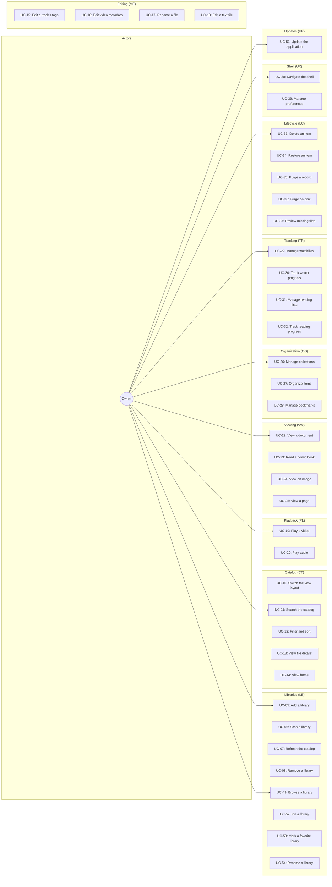
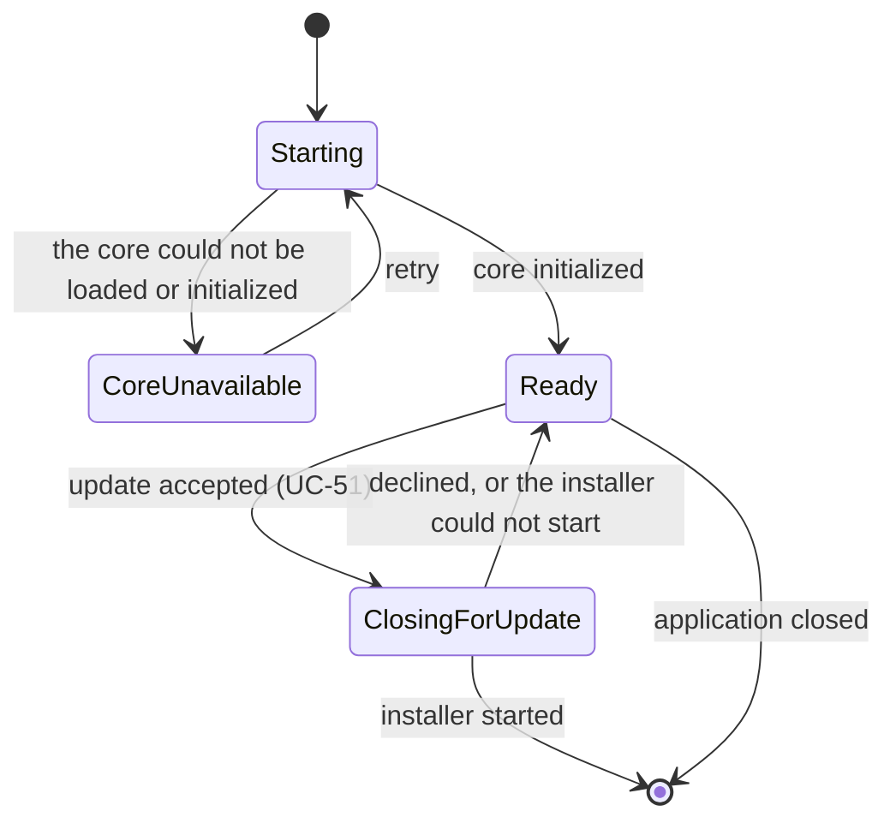
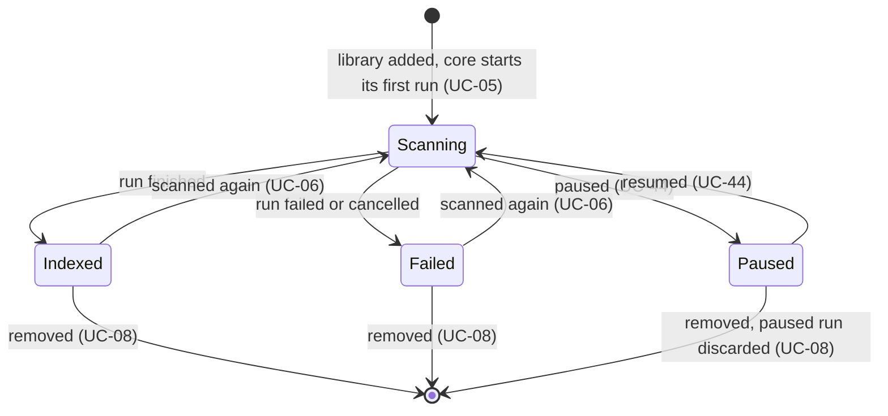
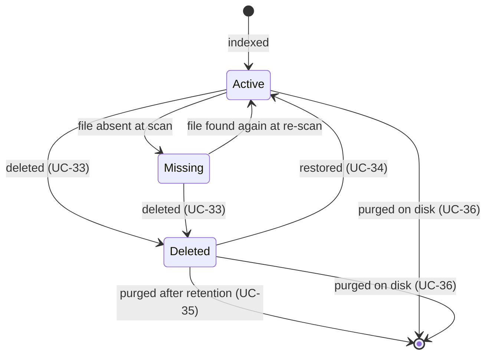
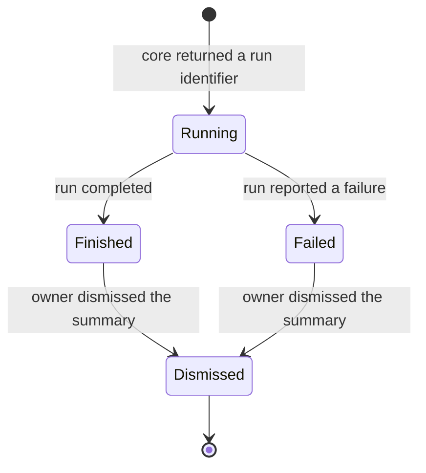
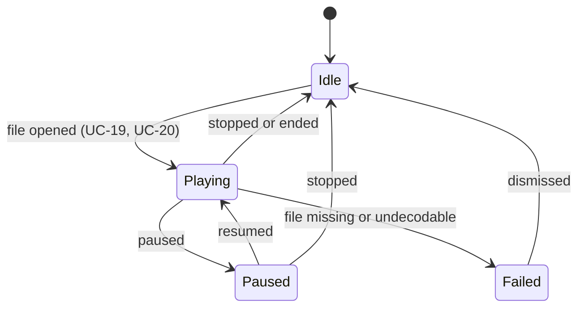
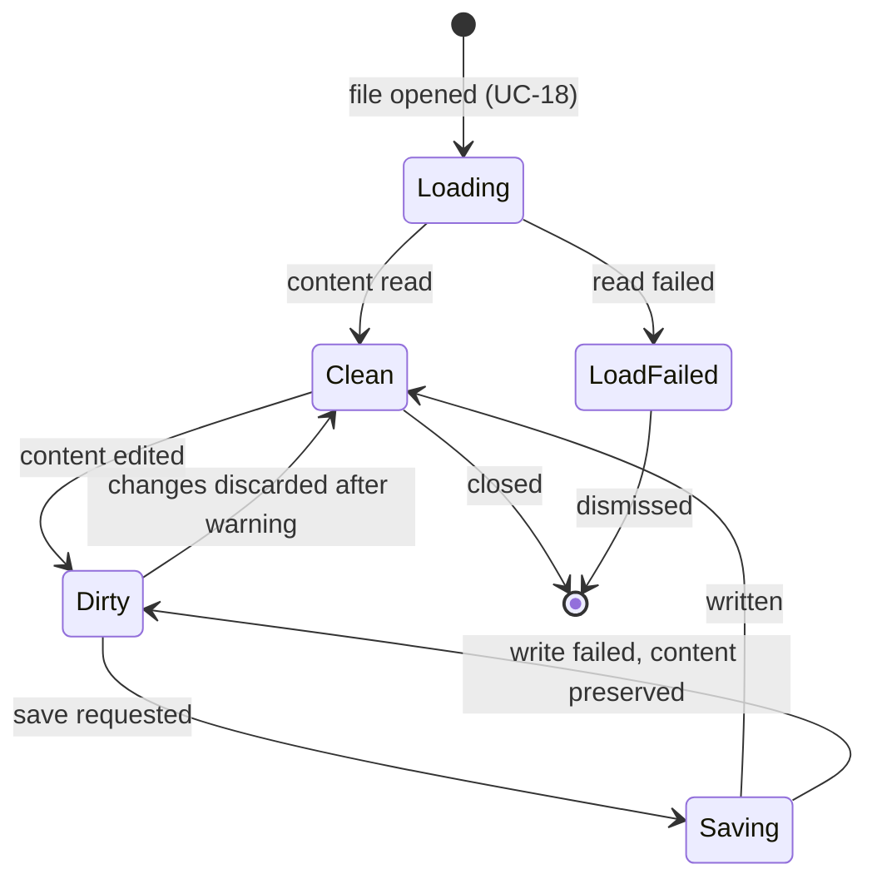

# Use Case Specification Document — Alexandria UI

## 1. Introduction

### 1.1 Purpose

This document specifies the use cases for **Alexandria UI**. Each use case
describes actor interactions, preconditions, postconditions, main flows, and
alternative/exception flows.

Every identifier appearing in a flow is the **public UUID** the Alexandria core
returns, per
[System Requirements §4.0](System%20Requirements%20Document.md). The core's
internal keys never cross the FFI boundary and never appear here.

Three conditions recur in almost every use case and are stated once here rather
than repeated as an alternative flow in each:

- **The core is unavailable.** A failure to reach or initialize the core is
  presented as a readable message with a retry rather than terminating the
  application (`NFR-14`).
- **Every failure is readable.** No flow below ever ends in a raw status code or
  a silent no-operation (`FR-UX-09`).
- **There is no login.** Core 0.7 removed authentication, so the application
  starts straight into the shell once the core is initialized, and no use case
  waits on a session. The use cases that signed the owner up, in, and out, and
  recovered access (UC-01 … UC-04, UC-40 … UC-42), are kept below only as
  Removed stubs so that their numbers are never reused, and so is every
  alternative flow that handled a call the core rejected as unauthorized.

### 1.2 Actors

| Actor | Description |
| --- | --- |
| **Owner** | The single human user, and the only actor with access to any catalog operation. Interacts with every use case below. |
| **Alexandria core** | The Rust library linked in process over FFI. Owns the catalog, the database, and every domain rule. Every catalog change in these flows is performed by it, never by the application. |
| **Local filesystem** | The disk holding the library folders. Read directly for media and document bytes; written only by the core, except for the application's own settings and log, and an accepted update's download and pending-update record (UC-51). |
| **Default browser** | The platform's configured web browser. Involved only when a bookmark is opened, or a release page (UC-51). |
| **GitHub releases** | GitHub's public releases API and the packages each release publishes. Asked for the latest release at startup and on "Check now", and downloaded from only when the owner accepts an update (UC-51). |

### 1.3 Use Case Overview

---

## 2. Use Case Specifications

---

### UC-01: Sign up

**Removed (0.7 core)** — Core 0.7 removed authentication: there is no account to
create, and the application opens the shell as soon as the core is initialized
(UC-38). The application runs only on the owner's machine, over their own files,
so a login protected nothing.

---

### UC-02: Log in

**Removed (0.7 core)** — There is no account to sign in to. The shell is the
first screen after startup (UC-38), and every use case below is reachable from
it.

---

### UC-03: Sign out

**Removed (0.7 core)** — There is no session to end. Playback stops and the
application's activities end when it closes for an update (UC-51) or exits.

---

### UC-04: Change credentials

**Removed (0.7 core)** — There are no credentials to change. Preferences keeps
the theme, the language, the startup re-check, and the update check (UC-39).

---

### UC-05: Add a library

| Field | Value |
| --- | --- |
| **ID** | UC-05 |
| **Name** | Add a library |
| **Actors** | Owner, Alexandria core, Local filesystem |
| **Description** | The owner adds a folder on disk as a library, which is the only way its files reach the catalog. The core starts indexing it straight away. Several may be added. |
| **Preconditions** | The application is running. |
| **Postconditions** | The core holds the library, it is listed in the left menu, and its first index run is under way and followed wherever the library's run is shown. |
| **Requirements** | FR-LB-01, FR-LB-02, FR-LB-03, FR-LB-04, FR-LB-11, FR-LB-12, FR-LB-27, FR-CT-20 |

**Main Flow**

1. The owner starts adding a library: from the Library menu's "Add library…",
   from "Add a library" in Manage libraries (the Library menu's "Manage
   libraries…"), from the left menu's "Add a library" entry while there is
   none, or from the button home's first-run guidance and an empty search
   show. No screen opens for it: the picker and the name question open over
   whatever is showing.
2. The owner opens the platform's native folder picker and chooses a folder.
3. The application asks what to call the library, offering the folder's name.
   Confirm is disabled while the name is blank, as it is when a library is
   renamed (UC-54).
4. The application asks the core to register the folder as a library. The core
   checks the folder, records the library, and starts its first index run.
5. The application reloads the libraries, so the new one takes its place in the
   left menu, A–Z among the libraries that are not pinned, and follows that run
   under its row in Manage libraries and in its page header (UC-06 step 3
   onwards), at the normal pace; the run can be slowed from the background
   activity indicator (UC-45).

**Alternative Flows**

| ID | Condition | Outcome |
| --- | --- | --- |
| AF-01 | The owner cancels the picker | Nothing is added and what was showing is unchanged. |
| AF-02 | The core refuses the folder as invalid — not a folder, missing, or outside the core's root | The application states the core's reason and adds nothing. |
| AF-03 | The core refuses the folder as overlapping another library | The application says the folder is already inside, or holds, another library, and adds nothing. A file in two libraries would have two answers to where it lives. |
| AF-04 | The owner cancels the name question | Nothing is added. |
| AF-05 | **Removed (0.7 core)** | The core no longer authenticates, so no call is rejected as unauthorized and there is no session to discard. |

> **The core judges the folder.** Which folder may be a library is the core's
> rule (BR-01), so the application asks rather than checking the disk itself
> first, and shows the core's refusal in the core's terms.
>
> **Rewritten for the 0.6 core.** This was *Register a library folder*: a
> source folder kept in the application's settings, with a question about which
> file types its index recorded, and an optional marking as a library. The 0.6
> core has no free-form indexing, so a folder is a library or is not in the
> catalog at all, and the question of types went with it.
>
> **Amended for library navigation.** The Libraries screen became the Manage
> libraries dialog, reached from the Library menu, and adding a library runs
> where the owner is rather than sending them to a screen first.

---

### UC-06: Scan a library

| Field | Value |
| --- | --- |
| **ID** | UC-06 |
| **Name** | Scan a library |
| **Actors** | Owner, Alexandria core, Local filesystem |
| **Description** | The owner scans a library again and watches it complete without the interface locking up. A library's first scan, started when it is added (UC-05), is followed the same way. |
| **Preconditions** | At least one library exists. |
| **Postconditions** | The catalog contains the library's files. The run's outcome is shown with the library's run status, under its row in Manage libraries and in its page header. |
| **Requirements** | FR-LB-05, FR-LB-07, FR-LB-08, FR-LB-09, FR-LB-23, FR-LB-27, FR-CT-21 |

**Main Flow**

1. The owner chooses "Scan again" — from the menu in the library's page header
   (UC-49), or on its row in Manage libraries.
2. The application asks the core to start an index run of the library and
   retains the run identifier it returns.
3. The application presents the run as in progress under the library's row in
   Manage libraries and in its page header, and leaves browsing, playback,
   viewing, and editing available.
4. The application observes the run's progress off the interface thread.
5. The run finishes; the application presents the outcome — files added, files
   updated, files found missing — and keeps it visible until dismissed.
6. The application refreshes home's statistics and the open library folder.

**Alternative Flows**

| ID | Condition | Outcome |
| --- | --- | --- |
| AF-01 | A run of that library is running or paused | The core refuses to start a second one; the application shows the core's sentence, which names the unfinished run, beside the library, and the owner can pause, resume, or cancel that run (UC-44). |
| AF-02 | The core rejects the start as invalid input | The application presents the reason. |
| AF-03 | The library's folder disappeared or became unreadable | The application presents the failure; if the folder moved, the owner corrects it (UC-49 AF-06), and otherwise may remove the library (UC-08). |
| AF-04 | The run reports files missing on disk | The outcome links to the missing-files review (UC-37). |
| AF-08 | The run reports files it could not record | The outcome says so in the screen's warning colours rather than as a clause on the summary line: those files are on disk and absent from the library, and no other screen will ever mention them. It happens under write contention, where a file's insert exhausts the core's retry bound — the core counts it and carries on rather than abandoning the walk. The outcome also offers to name them (FR-LB-23), because a count alone leaves the owner nowhere to look, and the remedy is another run, which the library's menu and its row already offer beside the report. |
| AF-05 | The application is closed while a run is in flight | The run belongs to the core; its outcome is presented at the next launch. |
| AF-06 | **Removed (0.7 core)** | The core no longer authenticates, so no call is rejected as unauthorized and there is no session to discard. |
| AF-07 | **Removed (0.6 core)** | A run no longer carries a file-type scope, so there is no recorded scope to refuse. |

> **A library's run status lasts while the application runs.** A library shows
> the run the application is following, or one the core lists as running or
> paused; otherwise the outcome of the last run followed since startup; and
> with neither, nothing. The
> core does not list finished runs per library, and keeping one in the
> application's settings would bring back the folder store FR-LB-03 removed.

---

### UC-07: Refresh the catalog

| Field | Value |
| --- | --- |
| **ID** | UC-07 |
| **Name** | Refresh the catalog |
| **Actors** | Owner, Alexandria core, Local filesystem |
| **Description** | Everything already cataloged is re-checked, across every library at once — either because the owner asked for it ("Re-check all libraries" in Manage libraries), or once, unannounced, when startup is ready (FR-LB-21). |
| **Preconditions** | The catalog is not empty. |
| **Postconditions** | Every cataloged record is refreshed; changed files are updated and absent files are marked missing. |
| **Requirements** | FR-LB-06, FR-LB-07, FR-LB-08, FR-LB-21 |

**Main Flow**

1. The owner starts a refresh, or startup becomes ready with the re-check
   preference on (FR-LB-21).
2. The application calls the core's refresh operation and retains the run
   identifier.
3. The application presents the run as in progress, without blocking the interface.
4. The run finishes; the application presents what was updated and what is now
   missing, and keeps it visible until dismissed.
5. The application refreshes home's statistics and the open library folder.

**Alternative Flows**

| ID | Condition | Outcome |
| --- | --- | --- |
| AF-01 | A refresh is already in flight | Owner-started: the application points at the running one rather than starting a second. Started at startup: the check is silently not repeated — nothing is presented, because nobody asked (FR-LB-21). |
| AF-02 | The catalog is empty | Owner-started: the application offers to add a library instead (UC-05). Started at startup: nothing is presented; the offer is what the owner already sees on an empty catalog regardless. |
| AF-03 | The refresh marks files missing | The outcome links to the missing-files review (UC-37). |
| AF-04 | **Removed (0.7 core)** | The core no longer authenticates, so no call is rejected as unauthorized and there is no session to discard. |
| AF-05 | The owner has turned the startup re-check off, or a run the core already had outstanding covers it (FR-LB-19) | Started at startup only: no refresh is started, and nothing is presented. |

---

### UC-08: Remove a library

| Field | Value |
| --- | --- |
| **ID** | UC-08 |
| **Name** | Remove a library |
| **Actors** | Owner, Alexandria core |
| **Description** | The owner removes a library, which deletes its records from the catalog. Nothing on disk is touched. |
| **Preconditions** | The library exists, and no run of it is running. |
| **Postconditions** | The library, its files' records with their reading and watching positions and collection membership, and its runs are gone from the catalog. The files on disk are untouched. |
| **Requirements** | FR-LB-10, FR-PL-19, FR-LB-27, FR-CT-20, FR-CT-21 |

**Main Flow**

1. The owner chooses "Remove" — from the menu in the library's page header
   (UC-49), or on its row in Manage libraries.
2. The application presents a confirmation stating that the library is deleted
   from the catalog with its files, their reading and watching positions, and
   their place in collections, and that nothing on disk is touched.
3. The owner confirms.
4. The application asks the core to remove the library.
5. The application stops following the library's run, reloads the outstanding
   runs, and refreshes the libraries — the left menu, home's favorites, and
   Manage libraries — home's statistics, and the collections. Any of the
   library's tracks leave the player's queue.

**Alternative Flows**

| ID | Condition | Outcome |
| --- | --- | --- |
| AF-01 | The owner cancels | Nothing changes. |
| AF-02 | A run of that library is running | The core refuses until the run is paused, cancelled, or finished; the application shows the core's sentence. |
| AF-03 | It is the last library | The application removes it; home presents the first-run guidance again, and the left menu offers "Add a library". |
| AF-04 | The library has a paused run | The confirmation also says that the paused scan is discarded; the core deletes it with the library. |
| AF-05 | The track playing belongs to the library | Playback stops when the library is removed (FR-PL-19). |
| AF-07 | The library removed is the one open in the main area | The shell goes to Home (FR-CT-20). |
| AF-06 | **Removed (0.7 core)** | The core no longer authenticates, so no call is rejected as unauthorized and there is no session to discard. |

> **Rewritten for the 0.6 core.** This was *Unregister a library folder*, which
> left the catalog untouched. In 0.6 a file is in the catalog only because it is
> inside a library, so removing the library removes its records — which is why
> the confirmation says so in plain terms rather than implying the files go
> somewhere else.

---

### UC-09: Browse the library by type

**Removed (navigation by library)** — The left menu no longer lists file types,
and there are no per-type pages. Files are browsed in their library's folders,
with a type filter (UC-49, UC-12), and found across every library by search
(UC-11). The count of each type moved to home's statistics (UC-14).

---

### UC-10: Switch the view layout

| Field | Value |
| --- | --- |
| **ID** | UC-10 |
| **Name** | Switch the view layout |
| **Actors** | Owner |
| **Description** | The owner chooses between list, list with details, and grid for a library's files, and the choice holds for every library. |
| **Preconditions** | A library is open in the main area (UC-49). |
| **Postconditions** | The open folder's files are drawn in the chosen layout, and the choice is remembered for every library. |
| **Requirements** | FR-CT-03, FR-CT-04 |

**Main Flow**

1. The owner selects one of the three layouts in the library's toolbar.
2. The application draws the open folder in that layout — its folders first,
   then its files.
3. The application records the choice in the local settings: one choice for
   every library, with the type filter and the sort (UC-12).
4. Opening another library, or this one after a restart, draws the same layout.

**Alternative Flows**

| ID | Condition | Outcome |
| --- | --- | --- |
| AF-01 | The window is too narrow for the chosen layout | The application renders the closest layout that fits and indicates the substitution rather than clipping columns. |
| AF-02 | The settings store cannot be written | The layout still changes while the application runs, and the toolbar says that it will not be remembered next time. |

> **Rewritten for library navigation.** The layout was chosen per file type, on
> the type's page. With the type pages gone it is one choice for every library:
> the owner reads their libraries one way, and a grid chosen in one folder that
> vanished in the next would look like the choice had not been kept.

---

### UC-11: Search the catalog

| Field | Value |
| --- | --- |
| **ID** | UC-11 |
| **Name** | Search the catalog |
| **Actors** | Owner, Alexandria core |
| **Description** | The owner finds items by name or metadata across every type at once. |
| **Preconditions** | The application is running. |
| **Postconditions** | Matching items are listed, grouped by type. |
| **Requirements** | FR-CT-06, FR-CT-09, FR-LB-04 |

**Main Flow**

1. The owner enters a search term.
2. The application matches it against file names and the type-specific metadata
   the core exposes for the loaded catalog.
3. The application presents the matches grouped by type, with the matched term
   highlighted, each naming the library it lives in. A track is named by its
   tags (FR-CT-13).
4. The owner opens a result, which behaves exactly as opening it from its folder
   (UC-13).

**Alternative Flows**

| ID | Condition | Outcome |
| --- | --- | --- |
| AF-01 | Nothing matches | The application presents an empty-result state naming the term, distinct from loading and error. |
| AF-02 | The term is blank or whitespace | The application clears the search and restores what was showing before. |
| AF-03 | The catalog is still loading | The application searches what has loaded and indicates that results may grow as loading completes. |
| AF-04 | The catalog is empty | The application offers to add a library instead (UC-05). |

> **Bookmarks are not searched.** `FR-CT-06` matches file names and the
> type-specific metadata the core exposes for files; a bookmark is neither a
> file nor carries that metadata. The search field is therefore not offered on
> the bookmarks area (UC-28), where it could only have replaced the bookmarks
> with matching files. Bookmarks are narrowed by their own collection filter
> instead. Searching them is a change to `FR-CT-06`, not to this flow.

---

### UC-12: Filter and sort a listing

| Field | Value |
| --- | --- |
| **ID** | UC-12 |
| **Name** | Filter and sort a listing |
| **Actors** | Owner |
| **Description** | The owner narrows a library folder's files to one type, and orders them. |
| **Preconditions** | A library is open in the main area (UC-49). |
| **Postconditions** | The open folder shows its folders, then the chosen type's files in the chosen order, and the choices are remembered for every library. |
| **Requirements** | FR-CT-07, FR-CT-08, FR-CT-19 |

**Main Flow**

1. The owner opens the type filter in the library's toolbar and chooses all
   types, or one of the seven: videos, music, books, comic books, notes, pages,
   or images.
2. The application shows the open folder's files of that type. Folders are
   never filtered, and always come first, A–Z.
3. The owner opens the sort and chooses name, date indexed, or album, and
   ascending or descending.
4. The application orders the files and draws them again.
5. The application records the filter and the sort in the local settings: one
   choice for every library, with the layout (UC-10).

**Alternative Flows**

| ID | Condition | Outcome |
| --- | --- | --- |
| AF-01 | The folder has files, but none of the chosen type | The application says "No <type> in this folder", with a button that clears the filter. |
| AF-02 | The owner clears the filter | Every type is shown again, and that is what is stored. |
| AF-03 | **Removed (navigation by library)** | A library's files are not filtered by collection: a collection's members are listed in Collections (UC-27). |
| AF-04 | **Removed (navigation by library)** | The filter and the sort are applied by the application to the folder the core returned, so there is nothing for the core to refuse. |
| AF-05 | The sort is album | Album artist (or artist), album, track number, title, untagged files last in file-name order (FR-CT-19). It is offered whatever the filter: a folder of tracks plays in the order shown (UC-20). |
| AF-06 | The settings store cannot be written | The choice still applies while the application runs, and the toolbar says that it will not be remembered next time. |

> **Rewritten for library navigation.** This filtered and sorted a type's page,
> by lifecycle state, with the choices kept per type. The type pages are gone;
> deleted records are reached through Deleted items (UC-34), never inside a
> library.

---

### UC-13: View a file's details

| Field | Value |
| --- | --- |
| **ID** | UC-13 |
| **Name** | View a file's details |
| **Actors** | Owner, Alexandria core |
| **Description** | The owner inspects one file's metadata, path, and state, and reaches every action available for it. |
| **Preconditions** | The file is in the catalog. |
| **Postconditions** | The file's current details are shown. |
| **Requirements** | FR-CT-05, FR-CT-12 |

**Main Flow**

1. The owner presses the details button on a file's row or tile, in a library's
   folder or in search results. Tapping the row
   itself opens the file rather than its details: a reader, a viewer, or
   playback, according to its type. The details are one press away from
   wherever a file is listed, because everything else a file can have done to
   it — renaming, metadata, collections, deletion — is reached from them.
2. The application requests the file by its UUID from the core.
3. The core returns the record with its type-specific metadata.
4. The application presents the metadata, the on-disk path, and the lifecycle
   state, together with the actions the file's type allows.
5. The owner may open the file from here too, which hands off to the same
   viewer or player a tap on the row would — the details remain the way in for
   a file that cannot simply be opened.

**Alternative Flows**

| ID | Condition | Outcome |
| --- | --- | --- |
| AF-01 | The core reports the file as not found | The application says the file is no longer in the catalog and returns to where the owner was, refreshing it. |
| AF-02 | The record is soft-deleted | The application shows it as deleted and offers restore (UC-34) instead of editing. |
| AF-03 | The record is marked missing on disk | The application shows it as missing, offers a re-scan, and disables the actions that need the file. A tap on such a file's row opens these details rather than a reader, since there is nothing on disk to open. |
| AF-04 | No viewer is registered for the type | The application presents the details and reports that the file cannot be opened, leaving the other actions available. |
| AF-05 | **Removed (0.7 core)** | The core no longer authenticates, so no call is rejected as unauthorized and there is no session to discard. |

---

### UC-14: View the home dashboard

| Field | Value |
| --- | --- |
| **ID** | UC-14 |
| **Name** | View the home dashboard |
| **Actors** | Owner, Alexandria core |
| **Description** | The owner opens the application and sees their favorite libraries and the catalog's totals at a glance. |
| **Preconditions** | The application is running. |
| **Postconditions** | Home shows the favorite libraries, A–Z, and the totals: how many libraries, and how many files of each type. |
| **Requirements** | FR-CT-11, FR-CT-22, FR-LB-11 |

**Main Flow**

1. The application opens on home once startup is ready; the left menu's Home
   returns to it.
2. The application reads the libraries and the catalog's statistics from the
   core, each section on its own.
3. The favorites section shows the libraries marked as favorites (UC-53), A–Z
   by name, as cards: the name, the root folder, and the library's run status
   as Manage libraries shows it.
4. The statistics section shows "N libraries", then a row per type with its
   count — videos, music, books, comic books, notes, pages, and images — all
   seven, zeroes included.
5. The owner opens a favorite's card, and its library opens in the main area
   (UC-49).

**Alternative Flows**

| ID | Condition | Outcome |
| --- | --- | --- |
| AF-01 | No library has been added | Home presents the first-run guidance to add one (UC-05) in place of both sections. Only a list of libraries that loaded empty says so: while it loads, or when it failed, nothing is known. |
| AF-02 | No library is a favorite | The favorites section says "Mark a library as a favorite to see it here", rather than rendering empty. |
| AF-03 | A section's query fails | That section shows its own failure and retry; the other still renders. A total that could not be counted is never shown as a zero. |
| AF-04 | A run finishes, or a library is added or removed | The statistics are read again. |
| AF-05 | A favorite is renamed, unmarked, or removed | Its card follows: the new name in its place A–Z, or no card. |

> **Rewritten for library navigation.** Home showed recently added files, items
> in progress, per-type counts, and the last run's outcome; the owner chose
> their favorite libraries and the totals instead. Resume positions still work
> (UC-19, UC-30, UC-32): they are no longer listed here.

---

### UC-15: Edit a track's tags

| Field | Value |
| --- | --- |
| **ID** | UC-15 |
| **Name** | Edit a track's tags |
| **Actors** | Owner, Alexandria core |
| **Description** | The owner corrects an audio file's title, artist, album artist, album, year, genre, and track number. |
| **Preconditions** | The file is an active audio record. |
| **Postconditions** | The core holds the edited tags and every open view reflects them. |
| **Requirements** | FR-ME-01, FR-ME-03, FR-ME-05 |

**Main Flow**

1. The owner opens the tag form from an audio file's detail view, which shows
   the tags and the duration.
2. The application presents the current values.
3. The owner edits one or more fields.
4. The application validates the edited fields locally and sends the change to
   the core.
5. The core validates, persists, and returns the updated tags.
6. The application updates the detail view and every open listing — the track's
   name and its place in album order included — without a manual refresh.

**Alternative Flows**

| ID | Condition | Outcome |
| --- | --- | --- |
| AF-01 | Local validation fails | The application marks the field and does not call the core. |
| AF-02 | The core rejects the change as invalid | The application presents the core's reason as final, keeps the form open, and leaves the stored tags unchanged. |
| AF-03 | The core reports the file as not found | The application says the file is no longer in the catalog and closes the form. |
| AF-04 | Nothing was actually changed | The application closes the form without calling the core. |
| AF-05 | **Removed (0.7 core)** | The core no longer authenticates, so no call is rejected as unauthorized and there is no session to discard. |

> **Reinstated for the 0.6 core**, which knows audio files again. This was
> *Edit music metadata* until music left Alexandria; it comes back as the tags a
> track is listed and played by, with nothing of the music library that used to
> surround it.

---

### UC-16: Edit video metadata

| Field | Value |
| --- | --- |
| **ID** | UC-16 |
| **Name** | Edit video metadata |
| **Actors** | Owner, Alexandria core |
| **Description** | The owner corrects a video file's metadata, including whether it is a movie or a series. |
| **Preconditions** | The file is an active video record. |
| **Postconditions** | The core holds the edited metadata and every open view reflects it. |
| **Requirements** | FR-ME-02, FR-ME-03, FR-ME-05 |

**Main Flow**

1. The owner opens the metadata form from a video file's detail view.
2. The application presents the current values, including the movie-or-series
   marking.
3. The owner edits one or more fields.
4. The application validates locally and sends the change to the core.
5. The core validates, persists, and returns the updated metadata.
6. The application updates the detail view and every open listing.

**Alternative Flows**

| ID | Condition | Outcome |
| --- | --- | --- |
| AF-01 | Local validation fails | The application marks the field and does not call the core. |
| AF-02 | The core rejects the change | The application presents the reason and leaves the stored metadata unchanged. |
| AF-03 | The marking changes from series to movie while watch progress records episodes | The application warns that per-episode progress becomes single-item progress and asks for confirmation before calling the core. |
| AF-04 | The core reports the file as not found | The application says so and closes the form. |
| AF-05 | **Removed (0.7 core)** | The core no longer authenticates, so no call is rejected as unauthorized and there is no session to discard. |

---

### UC-17: Rename a file

| Field | Value |
| --- | --- |
| **ID** | UC-17 |
| **Name** | Rename a file |
| **Actors** | Owner, Alexandria core, Local filesystem |
| **Description** | The owner renames a file, which the core applies to the catalog and to the file on disk. |
| **Preconditions** | The file is an active record. |
| **Postconditions** | The file carries the new name in the catalog and on disk. |
| **Requirements** | FR-ME-04, FR-ME-05 |

**Main Flow**

1. The owner chooses to rename a file and enters the new name.
2. The application rejects names containing characters the host operating system
   forbids, and empty names, before calling.
3. The application sends the rename to the core.
4. The core renames the file on disk and updates the record.
5. The application reflects the new name in the detail view and every open
   listing.

**Alternative Flows**

| ID | Condition | Outcome |
| --- | --- | --- |
| AF-01 | The name is empty or contains forbidden characters | The application marks the field and does not call the core. |
| AF-02 | The core reports a disk failure | The application presents the failure and states that neither the catalog nor the file changed. |
| AF-03 | The core reports the file as not found | The application says the file is no longer in the catalog and refreshes the listing. |
| AF-04 | The new name equals the current one | The application closes the dialog without calling the core. |
| AF-05 | **Removed (0.7 core)** | The core no longer authenticates, so no call is rejected as unauthorized and there is no session to discard. |

---

### UC-18: Edit a Markdown or text file

| Field | Value |
| --- | --- |
| **ID** | UC-18 |
| **Name** | Edit a Markdown or text file |
| **Actors** | Owner, Alexandria core, Local filesystem |
| **Description** | The owner edits a note or text file, with a live preview, and saves the content back to disk. |
| **Preconditions** | The file is an active text record. |
| **Postconditions** | The file on disk holds the edited content and the core has refreshed its content hash. |
| **Requirements** | FR-ME-06, FR-ME-07, FR-ME-08, FR-ME-09, FR-ME-10 |

**Main Flow**

1. The owner opens a text or Markdown file for editing.
2. The application reads the content through the core.
3. The application presents the source alongside a live rendered preview.
4. The owner edits the content; the preview follows as they type.
5. The owner saves.
6. The application compares the content to what was loaded and, if it differs,
   sends it to the core.
7. The core writes the file and refreshes the record; the application marks the
   editor as saved.

**Alternative Flows**

| ID | Condition | Outcome |
| --- | --- | --- |
| AF-01 | The content is unchanged | The application skips the call and reports that there is nothing to save. |
| AF-02 | The owner leaves with unsaved changes | The application warns and offers to save, discard, or cancel. |
| AF-03 | The core reports a disk failure on write | The application presents the failure and leaves the editor content exactly as it was, unsaved. |
| AF-04 | The core reports the file as not found | The application reports that the file is no longer in the catalog and keeps the edited content on screen until the owner dismisses it, so nothing typed is lost silently. |
| AF-05 | The file changed on disk since it was loaded | The application warns before overwriting and lets the owner reload or continue. |
| AF-06 | **Removed (0.7 core)** | The core no longer authenticates, so no call is rejected as unauthorized and there is no session to discard. |

---

### UC-19: Play a video

| Field | Value |
| --- | --- |
| **ID** | UC-19 |
| **Name** | Play a video |
| **Actors** | Owner, Local filesystem |
| **Description** | The owner watches a movie or an episode, with full-screen, seeking, subtitles, and audio-track selection. |
| **Preconditions** | The file is an active video record whose file is present on disk. |
| **Postconditions** | Playback ran; a resume position is recorded. |
| **Requirements** | FR-PL-01, FR-PL-02, FR-PL-03, FR-PL-04, FR-PL-08, FR-PL-10 |

**Main Flow**

1. The owner opens a video file.
2. The application opens the file from its on-disk path in the video player,
   without transcoding.
3. The player offers pause and resume, seeking forward and backward, and
   full-screen toggling.
4. The owner selects a subtitle track, or turns subtitles off, from those the file
   provides.
5. The owner selects an audio track from those the file provides.
6. Playback stops or ends; the application records the resume position.

**Alternative Flows**

| ID | Condition | Outcome |
| --- | --- | --- |
| AF-01 | The file is absent from disk | The application reports it as missing, offers a re-scan, and does not start playback. |
| AF-02 | The file cannot be decoded | The application reports that the format cannot be played and returns to the detail view, without terminating. |
| AF-03 | The file carries no subtitle or no alternative audio track | Those controls state that none is available rather than being silently absent. |
| AF-04 | A resume position exists | The application offers to resume or start over before playing. |
| AF-05 | Music is playing in the player bar | The music pauses when the video opens (FR-PL-08). |

---

### UC-20: Play audio

| Field | Value |
| --- | --- |
| **ID** | UC-20 |
| **Name** | Play audio |
| **Actors** | Owner, Local filesystem |
| **Description** | The owner plays a track, and the list it was started from plays on, in a player bar that stays while they browse. |
| **Preconditions** | The file is an active audio record. |
| **Postconditions** | Playback ran. No resume position is recorded for music. |
| **Requirements** | FR-PL-05, FR-PL-06, FR-PL-08, FR-PL-18, FR-PL-19, FR-CT-13 |

**Main Flow**

1. The owner opens a track — from a library's folder, search, or its details.
2. The application builds the queue from where the track was started: the open
   folder's audio files in the order shown, after its type filter and sort
   (UC-12), or the track alone from search or its details. Deleted records are
   left out.
3. The application plays the track from its on-disk path in the player bar,
   docked at the bottom of the shell, which shows its cover, its title and
   artist, previous, play and pause, next, its position with seeking, and close.
4. The owner navigates elsewhere in the application; playback and the bar
   continue.
5. The owner pauses, resumes, seeks, and moves to the next or previous track.
   When a track ends, the next one plays.
6. Playback stops after the last track, or when the owner closes the bar.

**Alternative Flows**

| ID | Condition | Outcome |
| --- | --- | --- |
| AF-01 | A queued track is absent from disk or cannot be opened | The application skips it, says briefly in the bar which one it skipped, and plays the next (FR-PL-18). |
| AF-02 | Nothing left in the queue can be opened | Playback stops with a readable failure in the bar, offering a re-scan. |
| AF-03 | The owner opens a video | The music pauses (FR-PL-08). |
| AF-04 | **Removed (0.7 core)** | There is no signing out. Playback stops when the application closes for an update (UC-51) or exits. |
| AF-05 | The library holding a queued track is removed (UC-08) | Its tracks leave the queue; if the track playing is one of them, playback stops. |
| AF-06 | The owner presses the track's title in the bar | The track's details open (UC-13); playback continues. |

> **Reinstated, narrowed, for the 0.6 core.** Audio is one more type to play,
> not a music library to manage, which stays Orpheus's. There are no playlists
> (UC-47, UC-48), no play history or statistics (UC-50), no browsing by artist
> or album (UC-46), no full-window player (UC-21), no shuffle or repeat, and no
> resume position for a track.

---

### UC-21: See what is playing

**Removed (moved out of scope, see Orpheus)**

---

### UC-22: View a document

| Field | Value |
| --- | --- |
| **ID** | UC-22 |
| **Name** | View a document |
| **Actors** | Owner, Local filesystem |
| **Description** | The owner reads a PDF or an e-book, with page or chapter navigation and a remembered position. |
| **Preconditions** | The file is an active document record present on disk. |
| **Postconditions** | The document was displayed; the reading position is remembered. |
| **Requirements** | FR-VW-01, FR-VW-02, FR-VW-07, FR-VW-08 |

**Main Flow**

1. The owner opens a document.
2. The application resolves the viewer registered for the file's type.
3. The application reads the file's bytes from its on-disk path.
4. The viewer presents the document with page or chapter navigation.
5. The owner reads and navigates; the position is remembered.
6. The owner closes the viewer; no bytes are retained.

**Alternative Flows**

| ID | Condition | Outcome |
| --- | --- | --- |
| AF-01 | The file is absent from disk | The application reports it as missing and offers a re-scan. |
| AF-02 | The file is corrupt or not the format its extension claims | The viewer reports that the document cannot be read and returns to the detail view. |
| AF-03 | The document is encrypted or password-protected | The viewer reports that it cannot be opened; the application does not prompt for or store a password. |
| AF-04 | No viewer is registered for the type | The application reports it and leaves the file's other actions available. |

---

### UC-23: Read a comic book

| Field | Value |
| --- | --- |
| **ID** | UC-23 |
| **Name** | Read a comic book |
| **Actors** | Owner, Local filesystem |
| **Description** | The owner reads a comic book archive page by page. |
| **Preconditions** | The file is an active comic-book record present on disk. |
| **Postconditions** | The comic was displayed; the page position is remembered. |
| **Requirements** | FR-VW-03, FR-VW-07, FR-VW-08 |

**Main Flow**

1. The owner opens a comic book.
2. The application reads the archive's entries from its on-disk path without
   extracting it.
3. The viewer presents the pages in order, with page navigation and fit controls.
4. The owner reads; the page position is remembered.
5. The owner closes the viewer; nothing is left extracted on disk.

**Alternative Flows**

| ID | Condition | Outcome |
| --- | --- | --- |
| AF-01 | The file is absent from disk | The application reports it as missing and offers a re-scan. |
| AF-02 | The archive is corrupt | The viewer reports that the comic cannot be read and returns to the detail view. |
| AF-03 | The archive format is not supported by the bundled decoder | The viewer reports which format the file is and that it cannot be opened, leaving the file's other actions available. |
| AF-04 | An individual page cannot be decoded | The viewer skips it, marks the gap, and continues with the remaining pages. |

---

### UC-24: View an image

| Field | Value |
| --- | --- |
| **ID** | UC-24 |
| **Name** | View an image |
| **Actors** | Owner, Local filesystem |
| **Description** | The owner views an image, fitted to the window or zoomed. |
| **Preconditions** | The file is an active image record present on disk. |
| **Postconditions** | The image was displayed. |
| **Requirements** | FR-VW-04, FR-VW-07 |

**Main Flow**

1. The owner opens an image.
2. The application reads its bytes from the on-disk path.
3. The viewer presents it fitted to the window.
4. The owner zooms and pans, or returns to fit.
5. The owner moves to the next or previous image among those it was drawn with —
   the open library folder's, in the order shown.

**Alternative Flows**

| ID | Condition | Outcome |
| --- | --- | --- |
| AF-01 | The file is absent from disk | The application reports it as missing and offers a re-scan. |
| AF-02 | The image cannot be decoded | The viewer reports it and offers to move to the next image. |
| AF-03 | The image is very large | The viewer presents a downscaled render first and refines it, rather than blocking the interface. |

---

### UC-25: View a saved page

| Field | Value |
| --- | --- |
| **ID** | UC-25 |
| **Name** | View a saved page |
| **Actors** | Owner, Local filesystem |
| **Description** | The owner reads a saved HTML page, or a Markdown file rendered rather than edited. |
| **Preconditions** | The file is an active HTML or text record present on disk. |
| **Postconditions** | The page was displayed as rendered content. |
| **Requirements** | FR-VW-05, FR-VW-06, FR-VW-07 |

**Main Flow**

1. The owner opens an HTML page, or opens a Markdown file for reading.
2. The application reads the file's bytes from the on-disk path.
3. The viewer hands an HTML page to an embedded browser engine, which opens
   the file from its own path and draws it as the browser it was saved from
   would: its stylesheets, its layout, its media queries, its pictures, and
   its script. A Markdown file is not given to the engine — it was converted
   from text a moment ago and carries no styling of its own — and is drawn as
   widgets in the application's own type.
4. The owner reads, and may switch a Markdown file into the editor (UC-18).

**Alternative Flows**

| ID | Condition | Outcome |
| --- | --- | --- |
| AF-01 | The file is absent from disk | The application reports it as missing and offers a re-scan. |
| AF-02 | The page references assets that are absent | The page renders without them and indicates what could not be loaded. |
| AF-03 | The page contains script | The engine runs it, as a browser would. Where the engine could not be started and the markup renderer is drawing the page, nothing runs and the application says so. |
| AF-07 | The browser engine cannot be started | The page is drawn as widgets instead — its own stylesheets resolved onto the elements they select, its folder as the base for its pictures, no script and no embedded frame. The owner reads the page rather than an error. Where the reason is that this computer offers no sandbox for the engine (NFR-12), the viewer says so above the page. |
| AF-08 | The owner follows a link in the page | A web or mail address opens in the system's browser or mail client, and the page stays where it is. A link to another page in the same folder opens in the viewer. Anything else — a local file elsewhere, a program, another application's scheme, or a window the page's script opens on its own — does nothing. |
| AF-04 | The markup is malformed | The engine recovers from it, which is most of what a browser does. Where the markup renderer is drawing instead, it renders what it can and reports that the page may be incomplete. |
| AF-05 | The page embeds a frame | The engine loads it, as a browser would. The markup renderer, where it is drawing instead, presents the frame as a link to where it pointed. |
| AF-06 | A stylesheet the page names is on the network, or was not saved with it | It is not fetched, and the page is drawn with the styling it does have. A local sheet that is missing is named to the owner as any other missing asset is (AF-02). |

---

### UC-26: Manage collections

| Field | Value |
| --- | --- |
| **ID** | UC-26 |
| **Name** | Manage collections |
| **Actors** | Owner, Alexandria core |
| **Description** | The owner creates, renames, and deletes collections of files or of bookmarks. |
| **Preconditions** | The application is running. |
| **Postconditions** | The core holds the created, renamed, or deleted collection; contained items are preserved in every case. |
| **Requirements** | FR-OG-01, FR-OG-02, FR-OG-03 |

**Main Flow**

1. The owner opens the collections screen.
2. The owner creates a collection, giving it a name and choosing whether it holds
   files or bookmarks.
3. The application validates the name and sends the creation to the core.
4. The core creates the collection and returns it.
5. The owner renames a collection; the application validates and sends the change.
6. The owner deletes a collection; the application confirms, stating that the
   contained items are preserved and only the grouping is removed, and then calls
   the core.

**Alternative Flows**

| ID | Condition | Outcome |
| --- | --- | --- |
| AF-01 | The name is blank after trimming | The application marks the field and does not call the core. |
| AF-02 | The core rejects the name | The application presents the core's reason and keeps the form open. |
| AF-03 | The owner cancels a deletion | Nothing changes. |
| AF-04 | The core reports the collection as not found | The application says so and refreshes the collections list. |
| AF-05 | **Removed (0.7 core)** | The core no longer authenticates, so no call is rejected as unauthorized and there is no session to discard. |

---

### UC-27: Organize items into collections

| Field | Value |
| --- | --- |
| **ID** | UC-27 |
| **Name** | Organize items into collections |
| **Actors** | Owner, Alexandria core |
| **Description** | The owner adds items to a collection, removes them, and browses a collection's members. |
| **Preconditions** | At least one collection exists. |
| **Postconditions** | The collection's membership reflects the change; the items themselves are untouched. |
| **Requirements** | FR-OG-04, FR-OG-05, FR-OG-06, FR-OG-07 |

**Main Flow**

1. The owner opens a collection.
2. The application requests its members from the core and lists them, with
   breadcrumbs reflecting the owner's position in the collection hierarchy.
3. The owner adds one or more items of the collection's kind.
4. The application sends the additions to the core and refreshes the membership.
5. The owner removes an item; the application sends the removal to the core.
6. The item remains in the catalog and disappears only from this collection.

**Alternative Flows**

| ID | Condition | Outcome |
| --- | --- | --- |
| AF-01 | An item's kind does not match the collection's | The application does not offer it, and states why if the owner reaches it another way. |
| AF-02 | An item is already a member | The application reports it as already present and adds nothing. |
| AF-03 | The core reports the collection or the item as not found | The application says so and refreshes the membership. |
| AF-04 | Some of a multiple-item addition fail | The application reports exactly which succeeded and which did not. |
| AF-05 | **Removed (0.7 core)** | The core no longer authenticates, so no call is rejected as unauthorized and there is no session to discard. |

---

### UC-28: Manage bookmarks

| Field | Value |
| --- | --- |
| **ID** | UC-28 |
| **Name** | Manage bookmarks |
| **Actors** | Owner, Alexandria core, Default browser |
| **Description** | The owner creates, updates, lists, and opens browser bookmarks, optionally filed in bookmark collections. |
| **Preconditions** | The application is running. |
| **Postconditions** | The core holds the created or updated bookmark. |
| **Requirements** | FR-OG-08, FR-OG-09, FR-OG-10, FR-OG-11, FR-OG-12 |

**Main Flow**

1. The owner opens the bookmarks screen, optionally filtered to one bookmark
   collection.
2. The application requests the matching bookmarks from the core and lists them.
3. The owner creates a bookmark with a URL, a title, and optionally a collection.
4. The application validates that the URL parses and the title is not blank, then
   sends the creation to the core.
5. The owner updates a bookmark's URL, title, or collection; the application
   validates and sends the change.
6. The owner opens a bookmark; the application hands the URL to the default
   browser.

**Alternative Flows**

| ID | Condition | Outcome |
| --- | --- | --- |
| AF-01 | The URL does not parse, or the title is blank | The application marks the field and does not call the core. |
| AF-02 | The core rejects the bookmark | The application presents the core's reason and keeps the form open. |
| AF-03 | The named collection is not a bookmark collection | The application does not offer it, and states why if reached another way. |
| AF-04 | No default browser can be launched | The application reports it and offers to copy the URL instead. |
| AF-05 | The core reports the bookmark as not found | The application says so and refreshes the listing. |
| AF-06 | **Removed (0.7 core)** | The core no longer authenticates, so no call is rejected as unauthorized and there is no session to discard. |

---

### UC-29: Manage watchlists

| Field | Value |
| --- | --- |
| **ID** | UC-29 |
| **Name** | Manage watchlists |
| **Actors** | Owner, Alexandria core |
| **Description** | The owner creates and deletes watchlists and adds or removes the videos they track. |
| **Preconditions** | The application is running. |
| **Postconditions** | The core holds the watchlist and its membership; the videos themselves are preserved in every case. |
| **Requirements** | FR-TR-01, FR-TR-02, FR-TR-03, FR-TR-04 |

**Main Flow**

1. The owner opens the watchlists screen and creates a watchlist with a name.
2. The application validates the name and sends the creation to the core.
3. The owner adds a video to a watchlist, from the watchlist or from the video's
   detail view.
4. The application sends the addition to the core, which creates the progress
   entry.
5. The owner removes a video; the application sends the removal to the core.
6. The owner deletes a watchlist; the application confirms, stating that the
   videos are preserved and only the tracking is removed, then calls the core.

**Alternative Flows**

| ID | Condition | Outcome |
| --- | --- | --- |
| AF-01 | The name is blank after trimming | The application marks the field and does not call the core. |
| AF-02 | The file is not a video | The application does not offer the action, and states why if reached another way. |
| AF-03 | The video is already in that watchlist | The application says so and adds nothing. |
| AF-04 | The core reports the watchlist or video as not found | The application says so and refreshes the screen. |
| AF-05 | The owner cancels a deletion | Nothing changes. |
| AF-06 | **Removed (0.7 core)** | The core no longer authenticates, so no call is rejected as unauthorized and there is no session to discard. |

---

### UC-30: Track watch progress

| Field | Value |
| --- | --- |
| **ID** | UC-30 |
| **Name** | Track watch progress |
| **Actors** | Owner, Alexandria core |
| **Description** | The owner records how far through a movie or series they are, per watchlist. |
| **Preconditions** | The video is in the watchlist. |
| **Postconditions** | The core holds the updated watch state and progress. |
| **Requirements** | FR-TR-05, FR-TR-06, FR-TR-07 |

**Main Flow**

1. The owner opens a watchlist.
2. The application requests the watchlists and their items' progress from the core
   and presents each item's state.
3. The owner changes an item's watch state.
4. For a series, the owner also sets the current episode, and the total when known.
5. The application sends the update to the core.
6. The core persists it and returns the updated progress, which the application
   presents.

**Alternative Flows**

| ID | Condition | Outcome |
| --- | --- | --- |
| AF-01 | The item is a movie | Only the single-item state is offered; episode fields are not shown. |
| AF-02 | The episode number is not a positive whole number, or exceeds the stated total | The application marks the field and does not call the core. |
| AF-03 | The core rejects the state as invalid | The application presents the reason and leaves the stored progress unchanged. |
| AF-04 | The core reports the watchlist or item as not found | The application says so and refreshes the screen. |
| AF-05 | The same video is in several watchlists | Progress is set for this watchlist only; the others are unaffected. |
| AF-06 | **Removed (0.7 core)** | The core no longer authenticates, so no call is rejected as unauthorized and there is no session to discard. |

---

### UC-31: Manage reading lists

| Field | Value |
| --- | --- |
| **ID** | UC-31 |
| **Name** | Manage reading lists |
| **Actors** | Owner, Alexandria core |
| **Description** | The owner creates and deletes reading lists and adds or removes the books and comics they track. |
| **Preconditions** | The application is running. |
| **Postconditions** | The core holds the reading list and its membership; the books and comics themselves are preserved. |
| **Requirements** | FR-TR-08, FR-TR-09, FR-TR-10, FR-TR-11 |

**Main Flow**

1. The owner opens the reading-lists screen and creates a reading list with a
   name.
2. The application validates the name and sends the creation to the core.
3. The owner adds a book document or a comic book, from the list or from the
   item's detail view.
4. The application sends the addition to the core, which creates the progress
   entry.
5. The owner removes an item; the application sends the removal to the core.
6. The owner deletes a reading list; the application confirms, stating that the
   books and comics are preserved, then calls the core.

**Alternative Flows**

| ID | Condition | Outcome |
| --- | --- | --- |
| AF-01 | The name is blank after trimming | The application marks the field and does not call the core. |
| AF-02 | The file is neither a book document nor a comic book | The application does not offer the action, and states why if reached another way. |
| AF-03 | The item is already in that reading list | The application says so and adds nothing. |
| AF-04 | The core reports the reading list or item as not found | The application says so and refreshes the screen. |
| AF-05 | The owner cancels a deletion | Nothing changes. |
| AF-06 | **Removed (0.7 core)** | The core no longer authenticates, so no call is rejected as unauthorized and there is no session to discard. |

---

### UC-32: Track reading progress

| Field | Value |
| --- | --- |
| **ID** | UC-32 |
| **Name** | Track reading progress |
| **Actors** | Owner, Alexandria core |
| **Description** | The owner records how far through a book or a comic series they are, per reading list. |
| **Preconditions** | The item is in the reading list. |
| **Postconditions** | The core holds the updated read state and progress. |
| **Requirements** | FR-TR-12, FR-TR-13, FR-TR-14 |

**Main Flow**

1. The owner opens a reading list.
2. The application requests the reading lists and their items' progress from the
   core and presents each item's state.
3. The owner changes an item's read state.
4. For a comic that belongs to a series, the owner also sets the current issue,
   and the total when known.
5. The application sends the update to the core.
6. The core persists it and returns the updated progress, which the application
   presents.

**Alternative Flows**

| ID | Condition | Outcome |
| --- | --- | --- |
| AF-01 | The item is a standalone book | Only the single-item state is offered; issue fields are not shown. |
| AF-02 | The issue number is not a positive whole number, or exceeds the stated total | The application marks the field and does not call the core. |
| AF-03 | The core rejects the state as invalid | The application presents the reason and leaves the stored progress unchanged. |
| AF-04 | The core reports the reading list or item as not found | The application says so and refreshes the screen. |
| AF-05 | The same item is in several reading lists | Progress is set for this reading list only. |
| AF-06 | **Removed (0.7 core)** | The core no longer authenticates, so no call is rejected as unauthorized and there is no session to discard. |

---

### UC-33: Delete an item

| Field | Value |
| --- | --- |
| **ID** | UC-33 |
| **Name** | Delete an item |
| **Actors** | Owner, Alexandria core |
| **Description** | The owner hides a file or bookmark from the library, keeping it restorable and leaving any on-disk file untouched. |
| **Preconditions** | The record is active. |
| **Postconditions** | The record is soft-deleted and absent from the default listings. The on-disk file is unchanged. |
| **Requirements** | FR-LC-01, FR-LC-02, FR-LC-09 |

**Main Flow**

1. The owner chooses to delete a file or a bookmark.
2. The application presents a confirmation stating that the record will be hidden,
   that it remains restorable, and — for a file — that the file on disk is not
   affected.
3. The owner confirms.
4. The application sends the soft delete to the core.
5. The core marks the record deleted and returns it.
6. The application removes it from the default listings and refreshes home's
   statistics.

**Alternative Flows**

| ID | Condition | Outcome |
| --- | --- | --- |
| AF-01 | The owner cancels | Nothing changes. |
| AF-02 | The record is already deleted | The application says so and refreshes the listing. |
| AF-03 | The core reports the record as not found | The application says so and refreshes the listing. |
| AF-04 | The file is currently playing or open in a viewer or editor | The application warns, and stops playback or closes the viewer on confirmation. |
| AF-05 | **Removed (0.7 core)** | The core no longer authenticates, so no call is rejected as unauthorized and there is no session to discard. |

---

### UC-34: Browse and restore deleted items

| Field | Value |
| --- | --- |
| **ID** | UC-34 |
| **Name** | Browse and restore deleted items |
| **Actors** | Owner, Alexandria core |
| **Description** | The owner reviews what has been deleted, sees how long each remains restorable, and brings any of it back. |
| **Preconditions** | The application is running. |
| **Postconditions** | A restored record is active again and back in the default listings. |
| **Requirements** | FR-LC-03, FR-LC-04, FR-LC-09 |

**Main Flow**

1. The owner opens the deleted-items view.
2. The application requests soft-deleted records from the core.
3. The application lists them, showing for each how long it remains restorable.
4. The owner restores a record.
5. The application sends the restore to the core, which returns the reactivated
   record.
6. The application removes it from this view and refreshes the default listings
   and home's statistics.

**Alternative Flows**

| ID | Condition | Outcome |
| --- | --- | --- |
| AF-01 | Nothing is deleted | The view presents an empty state saying so. |
| AF-02 | The record's retention window has elapsed | The application shows it as no longer restorable and offers purge instead (UC-35). |
| AF-03 | The core reports the record as not found | The application says so and refreshes the view. |
| AF-04 | The on-disk file is gone since the deletion | The record is restored and immediately shown as missing (UC-37). |
| AF-05 | **Removed (0.7 core)** | The core no longer authenticates, so no call is rejected as unauthorized and there is no session to discard. |

---

### UC-35: Purge a record

| Field | Value |
| --- | --- |
| **ID** | UC-35 |
| **Name** | Purge a record |
| **Actors** | Owner, Alexandria core |
| **Description** | The owner permanently removes a deleted record from the catalog, leaving the file on disk alone. |
| **Preconditions** | The record is soft-deleted and its retention window has elapsed. |
| **Postconditions** | The record no longer exists in the catalog. The on-disk file is unchanged. |
| **Requirements** | FR-LC-05, FR-LC-07, FR-LC-09 |

**Main Flow**

1. The owner chooses to purge a record from the deleted-items view.
2. The application presents a confirmation stating that the record is removed
   permanently and that the file on disk is **not** removed.
3. The owner confirms.
4. The application sends the purge to the core.
5. The core removes the record and returns it as confirmation.
6. The application removes it from the view, refreshes home's statistics, and discards
   any resume position held for it.

**Alternative Flows**

| ID | Condition | Outcome |
| --- | --- | --- |
| AF-01 | The owner cancels | Nothing changes. |
| AF-02 | The retention window has not elapsed | The core rejects it; the application explains when purging becomes possible rather than showing a status code. |
| AF-03 | The record is not soft-deleted | The application offers deletion first (UC-33) and does not call the core. |
| AF-04 | The core reports the record as not found | The application says so and refreshes the view. |
| AF-05 | **Removed (0.7 core)** | The core no longer authenticates, so no call is rejected as unauthorized and there is no session to discard. |

---

### UC-36: Purge a file on disk

| Field | Value |
| --- | --- |
| **ID** | UC-36 |
| **Name** | Purge a file on disk |
| **Actors** | Owner, Alexandria core, Local filesystem |
| **Description** | The owner deletes both the catalog record and the physical file. This is the only operation in the application that removes the owner's data from disk. |
| **Preconditions** | The record exists. |
| **Postconditions** | The record and the file on disk are both gone. |
| **Requirements** | FR-LC-06, FR-LC-09 |

**Main Flow**

1. The owner reaches the purge-on-disk action, which is presented distinctly from
   every other deletion, is never a default action, and is never one interaction
   away from a listing row.
2. The application presents a confirmation naming the exact file path that will be
   deleted and stating that the deletion cannot be undone.
3. The owner confirms explicitly.
4. The application sends the purge-on-disk to the core.
5. The core removes the file from disk and the record from the catalog, and
   reports the outcome.
6. The application refreshes the listings and home's statistics and discards
   any resume position held for the file.

**Alternative Flows**

| ID | Condition | Outcome |
| --- | --- | --- |
| AF-01 | The owner cancels | Nothing changes — neither the record nor the file. |
| AF-02 | The file was already absent from disk | The core reports success with the file marked as not present; the application says the record was removed and no file was found. |
| AF-03 | The core reports a disk failure | The application states that neither the file nor the record was removed. |
| AF-04 | The core reports the record as not found | The application says so and refreshes the listing. |
| AF-05 | The file is playing or open | The application warns and stops playback or closes the viewer before proceeding. |
| AF-06 | **Removed (0.7 core)** | The core no longer authenticates, so no call is rejected as unauthorized and there is no session to discard. |

---

### UC-37: Review missing files

| Field | Value |
| --- | --- |
| **ID** | UC-37 |
| **Name** | Review missing files |
| **Actors** | Owner, Alexandria core |
| **Description** | The owner reviews the cataloged files that were not found on disk and decides what to do about them. |
| **Preconditions** | The application is running. |
| **Postconditions** | The owner has seen the missing files; no record has been removed on the application's initiative. |
| **Requirements** | FR-LC-08 |

**Main Flow**

1. The owner opens the missing-files review, from the Library menu or from an
   index run's outcome.
2. The application requests the count and the records the core reports as missing.
3. The application lists them with their last known paths.
4. The owner starts a re-scan (UC-06 or UC-07) to check whether the files
   returned. The review lists the libraries' roots as the places it looked.
5. Files found again leave the review; the rest remain listed.

**Alternative Flows**

| ID | Condition | Outcome |
| --- | --- | --- |
| AF-01 | No file is missing | The view presents an empty state saying so. |
| AF-02 | The owner decides to remove a missing record | The application routes them through deletion (UC-33) and purge (UC-35); it never removes a record because a file is absent. |
| AF-03 | **Removed (0.6 core)** | Every record belongs to a library, and removing a library removes its records (UC-08), so no missing record can come from a folder that is no longer one. |
| AF-04 | **Removed (0.7 core)** | The core no longer authenticates, so no call is rejected as unauthorized and there is no session to discard. |

---

### UC-38: Navigate the application shell

| Field | Value |
| --- | --- |
| **ID** | UC-38 |
| **Name** | Navigate the application shell |
| **Actors** | Owner |
| **Description** | The owner moves around the application by library, in a window that adapts to its size, with consistent loading, error, and confirmation behavior throughout. |
| **Preconditions** | The application is running. |
| **Postconditions** | The owner reached the screen they wanted; the window's geometry is remembered. |
| **Requirements** | FR-UX-01, FR-UX-02, FR-UX-03, FR-UX-08, FR-UX-09, FR-UX-10, FR-UX-11, FR-CT-20 |

**Main Flow**

1. Once startup is ready, the application presents the shell, on home: the
   menu bar, the left menu, and the main area. There is no login before it.
2. The left menu lists, top to bottom, Home, Bookmarks, the pinned libraries
   A–Z, a divider, and the other libraries A–Z. The owner picks one, with the
   pointer or the keyboard, and it opens in the main area; a library opens as
   its folders (UC-49).
3. The library-wide screens — adding and managing libraries, collections,
   watchlists, reading lists, deleted items, and the missing-files review — are
   in the menu bar's Library menu, and Preferences in its Settings menu.
4. The owner resizes the window; the shell adapts across the breakpoints,
   collapsing the left menu to labels beneath the icons, then to icons with
   tooltips, rather than clipping an entry. However many libraries there are,
   the left menu scrolls rather than dropping one.
5. Every perceptible operation shows a loading state while it runs.
6. Every failure appears as a localized, readable message; every destructive
   action is confirmed by a modal naming what will be removed.
7. The owner closes the application; the window size and position are recorded and
   restored at the next launch.

**Alternative Flows**

| ID | Condition | Outcome |
| --- | --- | --- |
| AF-01 | The window is resized below the minimum supported size | The window manager holds it at the minimum; the shell stays usable and nothing is clipped. |
| AF-02 | The stored geometry places the window off-screen, or on a display that no longer exists | The application opens at the default size on the primary display. |
| AF-03 | An operation fails while a loading state is showing | The loading state is replaced by the failure and a retry, never left spinning and never dismissed silently. |
| AF-04 | The core cannot be loaded or initialized at startup | The shell presents the core-unavailable message with a retry, rather than terminating. |
| AF-05 | The owner cancels a confirmation | Nothing changes, and the owner stays where they were. |
| AF-06 | No library has been added | The libraries part of the left menu is a single "Add a library" entry, which starts adding one (UC-05). |
| AF-07 | The libraries could not be read | The libraries part of the left menu is a single "Libraries didn't load. Try again" entry, which reads them again rather than opening anything. Home and Bookmarks are still there; an empty list would read as "you have none", a count nobody made. |
| AF-08 | The library open in the main area is removed | The shell goes to Home (FR-CT-20). |

> **Rewritten for library navigation.** The panel listed one entry per file
> type, with its count, beside Home, Bookmarks, and Libraries. The owner knows
> where things are by the folders they chose, so the left menu lists those
> instead (FR-CT-20), and library management moved to the menu bar.

---

### UC-39: Manage application preferences

| Field | Value |
| --- | --- |
| **ID** | UC-39 |
| **Name** | Manage application preferences |
| **Actors** | Owner |
| **Description** | The owner chooses the theme and the language, and those choices persist. |
| **Preconditions** | The application is running. |
| **Postconditions** | The chosen theme and language are applied and remembered. |
| **Requirements** | FR-UX-04, FR-UX-05, FR-UX-06, FR-UX-07, FR-UX-12 |

**Main Flow**

1. The owner opens Preferences from the menu bar's Settings menu. It holds the
   theme, the language, the startup re-check (FR-LB-21), and the update check
   (UC-51).
2. The owner chooses light, dark, or the system theme.
3. The application applies it immediately, taking every color from the active
   theme, without restarting.
4. The owner chooses Brazilian Portuguese or English.
5. The application applies it immediately, presenting every string from the
   localization catalog, without restarting.
6. The application persists both choices and restores them at the next launch.

**Alternative Flows**

| ID | Condition | Outcome |
| --- | --- | --- |
| AF-01 | The system theme changes while "system" is selected | The application follows the change immediately. |
| AF-02 | The settings store cannot be written | The choices apply while the application runs, and the application reports that they were not saved. |
| AF-03 | No preference has ever been set | The application starts on the system theme and the system language when it is one of the two supported, and English otherwise. |
| AF-04 | Playback or an index run is active | Both continue uninterrupted through a theme or language change. |
| AF-05 | **Removed (0.7 core)** | There is no session, so Preferences always offers every choice, and has no account section. |

---

### UC-40: Save the recovery codes

**Removed (0.7 core)** — There is no account, so the core mints no recovery
codes and there is nothing to show before the library opens.

---

### UC-41: Recover access with a recovery code

**Removed (0.7 core)** — There is no password to forget and no login screen to
recover from.

---

### UC-42: Regenerate the recovery codes

**Removed (0.7 core)** — There are no recovery codes to replace.

---

### UC-43: Follow a scan while it runs

| Field | Value |
| --- | --- |
| **ID** | UC-43 |
| **Name** | Follow a scan while it runs |
| **Actors** | Owner, Alexandria core |
| **Description** | The owner watches an index or refresh run make progress — from anywhere in the application, not only from the screen it was started on. |
| **Preconditions** | At least one run is outstanding, whether started since startup or left behind by a previous run of the application. |
| **Postconditions** | None — this is observation. The catalog is unchanged. |
| **Requirements** | FR-LB-07, FR-LB-13, FR-LB-14, FR-LB-15, FR-LB-19, FR-LB-20, FR-UX-08 |

**Main Flow**

1. A run is outstanding, so the application shows the background activity
   indicator in the shell.
2. The application asks the core which runs are outstanding, and does so
   repeatedly while any of them is running.
3. For each run the application presents the library it belongs to — or the
   catalog, for a refresh — its phase, how far through it is, and how long it
   has been working — counting only time the run spent working, not
   time it spent paused.
4. Where the run has reported a total, the application presents a remaining-time
   estimate derived from the rate it has observed itself.
5. When nothing is left running, the application stops asking. A run that has
   finished is reported once and then dismissed.

**Alternative Flows**

| ID | Condition | Outcome |
| --- | --- | --- |
| AF-01 | The run has not yet reported a total | The application presents the count processed so far and no estimate, rather than dividing by a total it does not have. |
| AF-02 | Several runs are outstanding at once | The application presents an aggregate line and its "View all" opens Manage libraries, where a specific run can be addressed under its library's row. One row has no space to say which run a control would act on. |
| AF-03 | One run's status cannot be read | That run stops being polled and the others continue. A single unreadable run never stops the application following the rest. |
| AF-04 | Every outstanding run is paused | The application says so rather than claiming work is under way, and offers the resume. |
| AF-05 | **Removed (0.7 core)** | The core no longer authenticates, so no call is rejected as unauthorized and there is no session to discard. |

---

### UC-44: Pause, resume, or cancel a scan

| Field | Value |
| --- | --- |
| **ID** | UC-44 |
| **Name** | Pause, resume, or cancel a scan |
| **Actors** | Owner, Alexandria core |
| **Description** | The owner stops a scan where it stands and picks it up later, or abandons it outright — from the library's run status (its row in Manage libraries, or its page header), or from the background activity indicator. |
| **Preconditions** | A run exists and is outstanding. |
| **Postconditions** | The core records the run paused, running again under the same identifier, or cancelled. Whatever the run already catalogued stays catalogued; nothing is undone. |
| **Requirements** | FR-LB-16, FR-LB-17, FR-LB-19, FR-LB-20, FR-UX-10 |

**Main Flow — pause**

1. The owner asks to pause a running scan.
2. The application asks the core to pause it, and reads the run back.
3. The run is presented as paused, keeping the point it reached.

**Main Flow — resume**

1. The owner asks to resume a paused scan.
2. The application asks the core to resume it, naming a pace only if the owner
   chose one.
3. The application reads the run back and follows it again.

**Main Flow — cancel**

1. The owner asks to cancel a scan.
2. The application confirms first, stating that the run is abandoned rather than
   paused (FR-UX-10). A pause is not confirmed — it is reversible.
3. On confirmation the application asks the core to cancel, and reads the run
   back.

**Alternative Flows**

| ID | Condition | Outcome |
| --- | --- | --- |
| AF-01 | The owner cancels the confirmation | Nothing is sent and the run continues. |
| AF-02 | The core refuses because the run has moved on since the control was rendered | The application reads the run back and presents its actual state, rather than surfacing an error about a race the owner did not cause. |
| AF-03 | The run resumes | Its progress restarts from zero for the new segment, and the application says so — a resumed run re-walks, and the reset must not read as lost work. |
| AF-04 | **Removed (0.7 core)** | The core no longer authenticates, so no call is rejected as unauthorized and there is no session to discard. |

---

### UC-45: Pace a scan

| Field | Value |
| --- | --- |
| **ID** | UC-45 |
| **Name** | Pace a scan |
| **Actors** | Owner, Alexandria core |
| **Description** | The owner chooses how hard a scan pushes, so a large library can be catalogued in the background without the application becoming unpleasant to use. |
| **Preconditions** | A run is outstanding. |
| **Postconditions** | The run carries the chosen pace, and keeps it across a further pause. |
| **Requirements** | FR-LB-18, FR-LB-16 |

**Main Flow**

1. A scan starts at the normal pace — adding a library and scanning one again
   do not ask.
2. To change the pace of a run already under way, the owner chooses normal or
   low from the background activity indicator; the application pauses the run
   and resumes it at that pace, because the pace is fixed for as long as a
   segment is walking. The core resolves the pace into how many files the run
   works on at a time.
3. The application states that the progress bar returns to zero, since a resume
   starts a new segment.

**Alternative Flows**

| ID | Condition | Outcome |
| --- | --- | --- |
| AF-01 | The owner resumes without naming a pace | The run keeps the pace it already had. Sending nothing is not a request to speed up, and a scan deliberately throttled must not quietly return to full speed. |
| AF-02 | The re-pace fails partway, leaving the run paused | The run is presented as paused, which is what it is, and the owner may resume it. |

---

### UC-46: Browse the music library

**Removed (moved out of scope, see Orpheus)**

---

### UC-47: Manage a playlist

**Removed (moved out of scope, see Orpheus)**

---

### UC-48: Play a playlist

**Removed (moved out of scope, see Orpheus)**

### UC-49: Browse a library

| Field | Value |
| --- | --- |
| **ID** | UC-49 |
| **Name** | Browse a library |
| **Actors** | Owner, Alexandria core |
| **Description** | The owner opens a library from the left menu, walks its folders as they are on disk in the main area, opens files from them, and acts on the library from its header. |
| **Preconditions** | At least one library has been added (UC-05). |
| **Postconditions** | None. Browsing changes nothing; the folder open in each library is remembered while the application runs. |
| **Requirements** | FR-CT-10, FR-CT-12, FR-CT-13, FR-CT-15, FR-CT-17, FR-CT-21, FR-LB-09 |

**Main Flow**

1. The owner picks a library in the left menu (UC-38), or a favorite's card on
   home (UC-14). It opens in the main area.
2. The header names the library, with its Pin and Favorite toggles (UC-52,
   UC-53), a menu with Rename (UC-54), Scan again (UC-06), Move, and Remove
   (UC-08), and the library's run status.
3. The application asks the core for what sits directly inside the library's
   root, and shows its folders first, A–Z, then its files, in the layout, type
   filter, and sort the owner chose (UC-10, UC-12). A track is named by its tags
   (FR-CT-13).
4. The owner opens a folder. The application asks for that level and shows it;
   the breadcrumbs above it — the library's root, then each folder down to the
   open one — open any level above.
5. The owner opens a file. It opens in the viewer or player registered for its
   type (FR-CT-12), with every action a file has — details, editing, renaming,
   deleting, adding to a collection or a list; a track plays with the open
   folder's audio files as its queue, in the order shown (UC-20).
6. The owner leaves for another library and comes back; the folder they were in
   is open again. A restart opens every library at its root.

**Alternative Flows**

| ID | Condition | Outcome |
| --- | --- | --- |
| AF-01 | No library has been added | The left menu offers "Add a library" in place of the libraries (UC-38 AF-06). |
| AF-02 | A folder in the library holds nothing the core catalogued | It is shown as an empty folder rather than hidden, and opening it says "Nothing in this folder". It still exists on disk, and hiding it would misdescribe the structure the library exists to preserve. |
| AF-03 | The library no longer exists — it was removed from another window | The main area states that it could not be read and offers to retry; once the list of libraries is read again without it, the shell goes to Home. |
| AF-04 | **Removed (0.6 core)** | Unmarking a library so that its files returned to the type panels no longer exists: a library's files are listed with every other, and removing a library deletes its records (UC-08). |
| AF-05 | **Removed (0.7 core)** | The core no longer authenticates, so no call is rejected as unauthorized and there is no session to discard. |
| AF-06 | The library's folder moved on disk | The owner chooses "Move…" in the header's menu, or on its row in Manage libraries, and picks where it is now. The library's files move with it and keep their identity, so the next scan walks the folder that is there. Nothing is re-indexed: these are the same files. |
| AF-07 | The folder picked already overlaps another library, or the catalog already holds files there | The application says which of the two it is, in those terms, and nothing moves. |
| AF-08 | A run of the library is running or paused | The core refuses the move; the application shows the core's sentence, which names the unfinished run (FR-LB-09). |
| AF-09 | Nothing under the library has been indexed yet | The root says so, and points at Scan again in the header's menu. |
| AF-10 | The library is renamed, or pinned or unpinned, while it is open | The header shows the new name or the new toggle at once, and the left menu sorts the library again. |

> **A library opens in the main area.** It was a dialog over the Libraries
> screen; it is now what the left menu opens, with the layout, type filter,
> and sort controls the type pages had brought over (library navigation). A
> deleted file is reached through Deleted items (UC-34), not inside its
> library.
>
> **A moved folder is corrected, not re-indexed.** Re-walking the new
> location would mint new records for the same files and leave the old ones to
> be found missing — taking with them every reference a watchlist, a reading
> position, or a collection holds. So the root and the paths beneath it are
> corrected together, which is the core's own guarantee (FR-FC-41), and the
> application's part is to ask which folder.
>
> **A library's folders are the way to its files.** Search (UC-11), the
> deleted-items and missing-files reviews, and the collection picker reach them
> too. Until the 0.6 core they were kept out of the type panels (FR-CT-16, now
> removed), and since library navigation there are no type panels at all
> (FR-CT-01, removed).

### UC-50: See what has been played most

**Removed (moved out of scope, see Orpheus)**

---

### UC-51: Update the application

| Field | Value |
| --- | --- |
| **ID** | UC-51 |
| **Name** | Update the application |
| **Actors** | Owner, GitHub releases, Local filesystem |
| **Description** | The application finds a newer release at startup, or when the owner asks, and offers it; the owner updates now, later, or never to that version, and a copy that can update itself downloads, verifies, installs, and starts the new version. |
| **Preconditions** | A release build is running, from an installation other than the Flatpak. At startup, "Check for updates at startup" is on (the default). |
| **Postconditions** | The owner is running the newer release; or has chosen to be asked again at the next start; or has skipped that version, which is remembered; or has been sent to the release page. Nothing unverified has run, and the owner's data is untouched. |
| **Requirements** | FR-UP-01, FR-UP-02, FR-UP-03, FR-UP-04, FR-UP-05, FR-UP-06, FR-UP-07, FR-UP-08, FR-UP-09, FR-UP-10, FR-UP-11, FR-UP-12, FR-UP-13, FR-UP-14, FR-UP-15 |

**Main Flow**

1. Startup reaches ready. In the background, the application asks GitHub's
   public releases API for the latest release, sending only the request, its
   `Accept` header, and `User-Agent: Alexandria/<version>`.
2. The latest release is newer than the running version, and is not a version
   the owner skipped.
3. The application shows the prompt over the shell, waiting first for any open
   dialog to close. It names
   the new version, says "You have <current>", and shows the release notes,
   with Update now, Later, and Skip this version.
4. The owner chooses Update now. The application downloads the package for
   this installation, showing its progress and a Cancel.
5. The application verifies the download's SHA-256 against the checksums file
   the release publishes.
6. The application closes for the update: it ends the application's activities,
   records the window's geometry, writes the pending-update record, starts the
   installer detached, and exits.
7. The installer replaces the installation, keeping the owner's data, and
   starts the application again.
8. At the next start, the application finds itself running the new version and
   deletes the pending-update record.

**Alternative Flows**

| ID | Condition | Outcome |
| --- | --- | --- |
| AF-01 | The owner chooses Later | The prompt closes and nothing is stored; the next start asks again. |
| AF-02 | The owner chooses Skip this version | The version is remembered and not offered at startup again. A release newer than it is offered as usual. |
| AF-03 | This copy cannot update itself — the `.deb`, the zip or tarball, MSIX, or an installation the owner cannot write to | The prompt says this copy can't update itself and offers "Open release page" in place of Update now, which opens the release in the default browser. |
| AF-04 | The release publishes no checksums for this installation | As AF-03: the application cannot verify what it would install, so it offers the release page. The first release that publishes checksums is installed by hand, once. |
| AF-05 | The download does not match its checksum, or the checksums file has no line for it | The download is deleted, the prompt says it could not be verified, and nothing runs. |
| AF-06 | The download fails | The partial file is deleted and the prompt says the update could not be downloaded. |
| AF-07 | The owner cancels the download | The partial file is deleted, and the offer stands as it was. |
| AF-08 | An edit is unsaved when the application closes for the update | The owner is asked first. "Update and discard" continues; declining returns to the offer and deletes the download, so the owner can save first. |
| AF-09 | A library scan is running when the application closes for the update | The owner is told that the scan will pause and can be resumed after the update (UC-44); confirming continues, and declining returns to the offer. |
| AF-10 | The update did not take: the next start is still running the old version | The installer started the old version again. The application deletes the pending-update record and, in the prompt's place, shows "The update to <version> did not complete", with "Open release page". |
| AF-11 | The check fails at startup — offline, timed out, rate-limited, a server error, or an unreadable answer | It is logged, and nothing is shown. Startup is neither slowed nor interrupted. |
| AF-12 | The owner chooses "Check now" in Preferences and nothing newer exists | The application says "You're up to date". A failed check says "Couldn't check for updates"; a newer release opens the prompt, even one the owner skipped. |
| AF-13 | The owner turns "Check for updates at startup" off | No request is made at startup. "Check now" still works. |
| AF-14 | The application runs from the Flatpak | It never checks, and Preferences shows neither the switch nor "Check now": the Flatpak has no network permission (FR-UP-15). |

> **One network call, and only one.** The check is the application's only
> request of its own: no telemetry, nothing about the owner or the library,
> and nothing beyond what any HTTPS request carries. It runs once per start,
> never periodically, and can be turned off.
>
> **Nothing unverified runs.** The packages are unsigned, so what the
> application installs is what HTTPS delivered and the release's SHA-256
> confirms. A release that cannot be checked is not installed by the
> application at all.
>
> **Closing for an update is its own path.** It asks about unsaved edits and a
> running scan; closing the window in the ordinary way does not, and is
> unchanged.
>
> **The check is not one of the application's activities.** The activities —
> the catalog, indexing, the editor, playback — begin once startup is ready and
> end when the application closes for an update. The check starts at the same
> moment, but it is never ended: ending it would cancel the very download the
> application is closing to install. It was an activity only while signing out
> had to cancel a download in flight, and there is no signing out.

---

### UC-52: Pin a library

| Field | Value |
| --- | --- |
| **ID** | UC-52 |
| **Name** | Pin a library |
| **Actors** | Owner, Alexandria core |
| **Description** | The owner pins a library so that it stays at the top of the left menu, or unpins it. |
| **Preconditions** | At least one library has been added (UC-05). |
| **Postconditions** | The core records whether the library is pinned, and the left menu lists it among the pinned libraries or among the others. The choice survives restarts. |
| **Requirements** | FR-LB-24, FR-CT-20, NFR-15 |

**Main Flow**

1. The owner right-clicks, or long-presses, the library's entry in the left
   menu and chooses "Pin" — or presses the Pin toggle in the library's page
   header (UC-49).
2. The application asks the core to pin the library, and reads the libraries
   again once the core has accepted.
3. The left menu lists the library among the pinned ones, A–Z, above the
   divider, with a pin on its icon; the header's toggle shows it pinned.
4. "Unpin", from the same two places, returns it below the divider, A–Z among
   the others.

**Alternative Flows**

| ID | Condition | Outcome |
| --- | --- | --- |
| AF-01 | The core refuses the change | Nothing moves and the toggle stays as it was, because the left menu only ever shows what the core holds; a snackbar says the change could not be saved. |
| AF-02 | Every library is pinned, or none is | No divider is drawn: a line with nothing on one side of it divides nothing. |
| AF-03 | The window is at its narrowest | The entry is its icon, with the pin, and the library's name as its tooltip (FR-UX-02). |

> **No order but A–Z.** The pinned libraries and the others are each sorted by
> name, without regard to case. There is no dragging to reorder: pinning is the
> one way the owner moves a library up.

---

### UC-53: Mark a favorite library

| Field | Value |
| --- | --- |
| **ID** | UC-53 |
| **Name** | Mark a favorite library |
| **Actors** | Owner, Alexandria core |
| **Description** | The owner marks a library as a favorite so that it is on home, or unmarks it. |
| **Preconditions** | At least one library has been added (UC-05). |
| **Postconditions** | The core records whether the library is a favorite, and home's favorites list it, A–Z, or no longer do. The choice survives restarts. |
| **Requirements** | FR-LB-25, FR-CT-11, NFR-15 |

**Main Flow**

1. The owner right-clicks, or long-presses, the library's entry in the left
   menu and chooses "Add to favorites" — or presses the Favorite toggle, a
   star, in the library's page header (UC-49).
2. The application asks the core to mark the library, and reads the libraries
   again once the core has accepted.
3. Home's favorites show the library's card, A–Z among the others (UC-14); the
   context menu's entry and the header's toggle show a filled star.
4. "Remove from favorites", from the same two places, takes the card off home.

**Alternative Flows**

| ID | Condition | Outcome |
| --- | --- | --- |
| AF-01 | The core refuses the change | Nothing changes, and a snackbar says the change could not be saved. |
| AF-02 | The last favorite is unmarked | Home's favorites say "Mark a library as a favorite to see it here" (UC-14 AF-02). |

> **Favorites and pins are separate.** A pin orders the left menu; a favorite
> puts a library on home. A library can be either, both, or neither. In
> Portuguese a favorite library is *preferida*: *Favoritos* already names the
> bookmarks.

---

### UC-54: Rename a library

| Field | Value |
| --- | --- |
| **ID** | UC-54 |
| **Name** | Rename a library |
| **Actors** | Owner, Alexandria core |
| **Description** | The owner gives a library another name, at any time — while it is being scanned included. |
| **Preconditions** | At least one library has been added (UC-05). |
| **Postconditions** | The core holds the new name, and the left menu, the library's page header, home's favorites, and Manage libraries all show it. |
| **Requirements** | FR-LB-26, FR-CT-20 |

**Main Flow**

1. The owner chooses "Rename…" — from the library's context menu in the left
   menu, from the menu in its page header (UC-49), or on its row in Manage
   libraries.
2. The application asks for the new name, with the current one filled in and
   selected. Confirm is disabled while the field is blank, the same rule as
   when a library is added (UC-05).
3. The owner confirms. The application asks the core to rename the library,
   and reads the libraries again once the core has accepted.
4. The new name is shown everywhere the library is, and the left menu sorts it
   again, A–Z within its group.

**Alternative Flows**

| ID | Condition | Outcome |
| --- | --- | --- |
| AF-01 | The owner cancels | Nothing changes. |
| AF-02 | The core refuses the name | The dialog stays open with the core's message, so the name typed is not lost. |
| AF-03 | A run of the library is running or paused | The rename is offered and saved all the same: a library's name is not something a scan reads. |

> **New with library navigation.** A library's name used to be set only when it
> was added. The folder on disk keeps its own name; only the library's changes.

---

## 3. Use Case — Requirements Traceability

| Use Case | Requirements |
| --- | --- |
| UC-01: Sign up | **Removed (0.7 core)** |
| UC-02: Log in | **Removed (0.7 core)** |
| UC-03: Sign out | **Removed (0.7 core)** |
| UC-04: Change credentials | **Removed (0.7 core)** |
| UC-05: Add a library | FR-LB-01, FR-LB-02, FR-LB-03, FR-LB-04, FR-LB-11, FR-LB-12, FR-LB-27, FR-CT-20 |
| UC-06: Scan a library | FR-LB-05, FR-LB-07, FR-LB-08, FR-LB-09, FR-LB-23, FR-LB-27, FR-CT-21 |
| UC-07: Refresh the catalog | FR-LB-06, FR-LB-07, FR-LB-08, FR-LB-21 |
| UC-08: Remove a library | FR-LB-10, FR-PL-19, FR-LB-27, FR-CT-20, FR-CT-21 |
| UC-09: Browse the library by type | **Removed (navigation by library)** |
| UC-10: Switch the view layout | FR-CT-03, FR-CT-04 |
| UC-11: Search the catalog | FR-CT-06, FR-CT-09, FR-CT-13, FR-LB-04 |
| UC-12: Filter and sort a listing | FR-CT-07, FR-CT-08, FR-CT-19 |
| UC-13: View a file's details | FR-CT-05, FR-CT-12, FR-CT-18 |
| UC-14: View the home dashboard | FR-CT-11, FR-CT-22, FR-LB-11 |
| UC-15: Edit a track's tags | FR-ME-01, FR-ME-03, FR-ME-05 |
| UC-16: Edit video metadata | FR-ME-02, FR-ME-03, FR-ME-05 |
| UC-17: Rename a file | FR-ME-04, FR-ME-05 |
| UC-18: Edit a Markdown or text file | FR-ME-06, FR-ME-07, FR-ME-08, FR-ME-09, FR-ME-10 |
| UC-19: Play a video | FR-PL-01, FR-PL-02, FR-PL-03, FR-PL-04, FR-PL-08, FR-PL-10 |
| UC-20: Play audio | FR-PL-05, FR-PL-06, FR-PL-08, FR-PL-18, FR-PL-19, FR-CT-13 |
| UC-21: See what is playing | **Removed (moved out of scope, see Orpheus)** |
| UC-22: View a document | FR-VW-01, FR-VW-02, FR-VW-07, FR-VW-08 |
| UC-23: Read a comic book | FR-VW-03, FR-VW-07, FR-VW-08 |
| UC-24: View an image | FR-VW-04, FR-VW-07 |
| UC-25: View a saved page | FR-VW-05, FR-VW-06, FR-VW-07 |
| UC-26: Manage collections | FR-OG-01, FR-OG-02, FR-OG-03 |
| UC-27: Organize items into collections | FR-OG-04, FR-OG-05, FR-OG-06, FR-OG-07 |
| UC-28: Manage bookmarks | FR-OG-08, FR-OG-09, FR-OG-10, FR-OG-11, FR-OG-12 |
| UC-29: Manage watchlists | FR-TR-01, FR-TR-02, FR-TR-03, FR-TR-04 |
| UC-30: Track watch progress | FR-TR-05, FR-TR-06, FR-TR-07 |
| UC-31: Manage reading lists | FR-TR-08, FR-TR-09, FR-TR-10, FR-TR-11 |
| UC-32: Track reading progress | FR-TR-12, FR-TR-13, FR-TR-14 |
| UC-33: Delete an item | FR-LC-01, FR-LC-02, FR-LC-09 |
| UC-34: Browse and restore deleted items | FR-LC-03, FR-LC-04, FR-LC-09 |
| UC-35: Purge a record | FR-LC-05, FR-LC-07, FR-LC-09 |
| UC-36: Purge a file on disk | FR-LC-06, FR-LC-09 |
| UC-37: Review missing files | FR-LC-08 |
| UC-38: Navigate the application shell | FR-UX-01, FR-UX-02, FR-UX-03, FR-UX-08, FR-UX-09, FR-UX-10, FR-UX-11, FR-CT-20 |
| UC-39: Manage application preferences | FR-UX-04, FR-UX-05, FR-UX-06, FR-UX-07, FR-UX-12 |
| UC-40: Save the recovery codes | **Removed (0.7 core)** |
| UC-41: Recover access with a recovery code | **Removed (0.7 core)** |
| UC-42: Regenerate the recovery codes | **Removed (0.7 core)** |
| UC-43: Follow a scan while it runs | FR-LB-07, FR-LB-13, FR-LB-14, FR-LB-15, FR-LB-19, FR-LB-20, FR-UX-08 |
| UC-44: Pause, resume, or cancel a scan | FR-LB-16, FR-LB-17, FR-LB-19, FR-LB-20, FR-UX-10 |
| UC-45: Pace a scan | FR-LB-16, FR-LB-18 |
| UC-46: Browse the music library | **Removed (moved out of scope, see Orpheus)** |
| UC-47: Manage a playlist | **Removed (moved out of scope, see Orpheus)** |
| UC-48: Play a playlist | **Removed (moved out of scope, see Orpheus)** |
| UC-49: Browse a library | FR-CT-10, FR-CT-12, FR-CT-13, FR-CT-15, FR-CT-17, FR-CT-21, FR-LB-09 |
| UC-50: See what has been played most | **Removed (moved out of scope, see Orpheus)** |
| UC-51: Update the application | FR-UP-01, FR-UP-02, FR-UP-03, FR-UP-04, FR-UP-05, FR-UP-06, FR-UP-07, FR-UP-08, FR-UP-09, FR-UP-10, FR-UP-11, FR-UP-12, FR-UP-13, FR-UP-14, FR-UP-15 |
| UC-52: Pin a library | FR-LB-24, FR-CT-20, NFR-15 |
| UC-53: Mark a favorite library | FR-LB-25, FR-CT-11, NFR-15 |
| UC-54: Rename a library | FR-LB-26, FR-CT-20 |

Every functional requirement in
[System Requirements §3](System%20Requirements%20Document.md) that has not been
removed appears at least once above.

---

## 4. State Diagrams

### 4.1 Application lifecycle

`Ready` is the shell, on home: there is no state between startup and the
library. The application's activities — the catalog, indexing, the editor,
playback — begin on entering it and end when the application closes for an
update; the update check starts with them but is not one of them (UC-51).

This was the *session lifecycle*, with `NoAccount`, `LoggedOut`,
`ShowingCodes`, and `Authenticated` states. Core 0.7 removed authentication,
and every one of those states went with it.

### 4.2 Library lifecycle

Removing a library deletes its catalog records — its files with their reading
and watching positions and collection membership, and its runs — and never
touches the files on disk. A library cannot be removed while it is
`Scanning`, nor moved or scanned again while it is `Scanning` or `Paused`.

### 4.3 Catalog record lifecycle, as the application presents it

`Missing` is a state, never a trigger: nothing in this diagram moves a record out
of the catalog because its file is absent.

### 4.4 Index run lifecycle

### 4.5 Playback lifecycle

### 4.6 Text editor lifecycle

